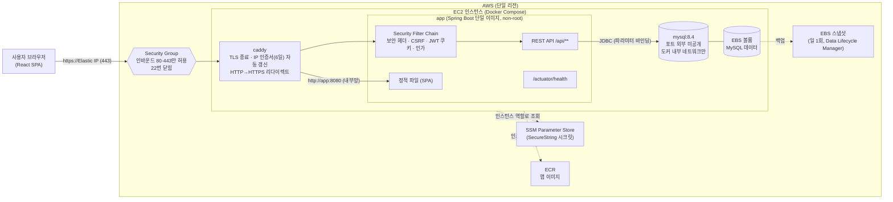
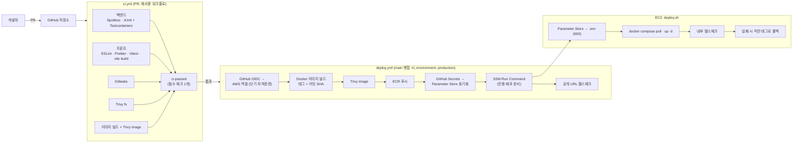
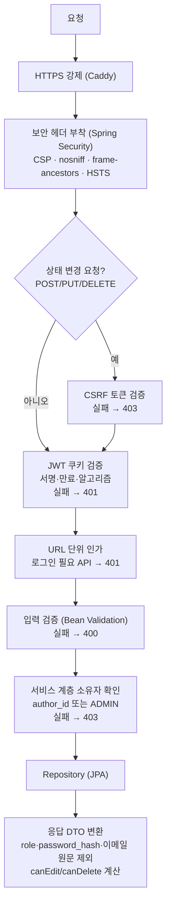

# 기술 스택 및 아키텍처 (MVP)

| 항목 | 내용 |
|---|---|
| 문서 버전 | v1.7 |
| 작성일 | 2026-10-13 (갱신 2026-10-24) |
| 상태 | **최종** (이 문서의 확인 필요 항목 없음) |
| 기준 문서 | 01 요구사항 문서 v0.6 |
| 관련 문서 | 03 하네스 문서 v0.8 |

### 변경 이력

| 버전 | 날짜 | 변경 내용 |
|---|---|---|
| v0.1 | 2026-10-13 | 초안 (후보 비교·추천안) |
| v1.0 | 2026-10-13 | Q1~Q5 결정 반영: 프론트 바닐라 JS, DB MySQL, 배포 AWS EC2 + Docker. tsc 제거·ESLint 규칙 보강, MySQL 기준 설정·마이그레이션, EC2 배포 구성·구성도 재작성 |
| v1.1 | 2026-10-13 | Q6 저장소 Public 확정 및 공개 저장소 운영 규칙 추가. 도메인 없음 → HTTPS를 Let's Encrypt **IP 주소 인증서**(Caddy)로 변경 (Q7), HSTS 한계·인증서 만료 감시 추가 |
| v1.2 | 2026-10-13 | Q7 확정: HTTPS는 Let's Encrypt IP 주소 인증서. 검토한 대안(DuckDNS 등 무료 서브도메인)의 기각 사유를 3.6절에 보강 |
| v1.3 | 2026-10-13 | 하네스 설계(03 문서) 반영: PR CI에 **이미지 빌드 + Trivy image** 추가, 필수 체크를 집계 잡 `ci-passed` 하나로 통일, Gradle **의존성 잠금 파일**(`gradle.lockfile`) 도입, 저장소 구조에 하네스 파일 추가, 서드파티 액션 SHA 고정 근거(trivy-action 태그 탈취 사고) 추가 |
| v1.4 | 2026-10-16 | 01 v0.4(자동 로그인 2종) 반영: 1장 원칙에 **리프레시 토큰 예외** 명시, 3.5절 리프레시 토큰 설계, 5.3 API(`POST /api/auth/refresh` 추가, 로그아웃 인증 불필요), 5.4 쿠키·흐름(리프레시 쿠키 `Path=/api/auth`), 5.6 `refresh_tokens` 테이블, 8장 SEC-16, T-13 |
| v1.5 | 2026-10-17 | 01 v0.5(게시글 AC 구체화) 반영: 4.3절 미결 메모 확정(공개 조회 API의 무효 토큰 = 401, T-14), 5.3 API 표에 게시글 요청·응답 형태, 5.6 `posts` 테이블 상세(`updated_at` NULL 허용, `deleted_by` FK, 목록 인덱스, `content` 매핑 주의), T-15 (관리자 판단은 DB role) |
| v1.6 | 2026-10-18 | 프론트엔드 구현 전 갱신: **라우팅 React Router 8**(T-16, 새 의존성), **5.8절 프론트엔드 구조** 신설(화면·경로, API 모듈 규칙, 로그인 상태, 오류 표시, 텍스트 렌더링), SPA 경로 포워딩(T-18), API 모듈의 401 연장 규칙(T-17)·연장 실패 처리(T-19), 잘못된 주소값 처리, CSP 값과 적용 시점(T-20), ESLint 우회 경로 차단(T-21). F-1 착수 시 보완: 연장 요청의 일시 오류는 logout하지 않음(T-19), 비표준 오류 본문·네트워크 오류 처리, `/api/` 밖 경로 거부. 01 요구사항 변경 없음 |
| v1.7 | 2026-10-24 | 01 v0.6(댓글·관리자 시드 AC 구체화) 반영: 5.3 API 표에 댓글 요청·응답 형태와 오류 순서, 5.6 `comments` 테이블 상세(V4), 5.8 댓글 화면(상세 화면에 붙임)과 PR 분리, 관리자 시드 구성(5.5절 보충), T-22~T-25. 새 의존성 없음 |

---

## 1. 결정 기준

| # | 기준 | 판단 방법 |
|---|---|---|
| C-1 | 혼자 개발·운영 가능 | 배포 단위 수, 직접 관리해야 하는 인프라의 양 |
| C-2 | 보안 기능 구현이 쉬움 | 인증·CSRF·해시·보안 헤더를 **프레임워크 기본 기능**으로 해결할 수 있는가 |
| C-3 | 테스트·린트·CI 하네스 구성이 쉬움 | 인가 테스트 지원, 실제 DB로 통합 테스트, 단일 명령 실행 |
| C-4 | GitHub Actions 자동배포 | 테스트·스캔 통과 후에만 배포하는 게이트를 명확히 만들 수 있는가 |
| C-5 | 팀 숙련도 | TypeScript 경험 없음 → 프론트는 JavaScript |

**원칙: 보안 코드는 직접 만들지 않는다.** JWT 서명 검증, 비밀번호 해시, CSRF 토큰, HTTPS 인증서는 검증된 프레임워크·도구를 쓰고, 직접 작성하는 보안 코드는 "설정"과 "소유자 확인(인가)"으로 최소화한다.

> **예외 (v1.4, T-13): 리프레시 토큰.** Spring Security는 JWT 쿠키 구조에 맞는 리프레시 토큰을 제공하지 않는다(Remember-Me는 세션·폼 로그인 전제). 그래서 **발급·교체·재사용 감지 흐름만 직접 작성**하고, 그 안의 암호 요소는 JDK 표준(`SecureRandom` 256비트, SHA-256)만 쓴다. 직접 만든 만큼 동작을 보안 회귀 테스트(S-17~S-21)로 고정한다.

---

## 2. 결정 요약 (최종)

| 영역 | 결정 | 상태 |
|---|---|---|
| 백엔드 | Java 21 + Spring Boot 4.x(4.1 이상) + Spring Security | 확정 |
| 프론트엔드 | React + Vite + **JavaScript** (SPA), 라우팅 **React Router 8** (v1.6) | 확정 (Q1, T-16) |
| 서빙 방식 | 프론트 빌드 결과를 백엔드 JAR에 포함 → 단일 출처(Same-Origin) | 확정 |
| DB | **MySQL 8.4 LTS** + Flyway | 확정 |
| 데이터 접근 | Spring Data JPA (파라미터 바인딩) | 확정 |
| 인증 | Spring Security OAuth2 Resource Server (JWT, HS256) + HttpOnly 쿠키 + CSRF 토큰. **로그인 상태 유지는 리프레시 토큰**(불투명 난수, DB 해시, 1회용 교체) | 확정 (v1.4) |
| 빌드 | Gradle (Kotlin DSL, **의존성 잠금 파일**), npm (`package-lock.json`) | 확정 |
| 테스트 | JUnit 5 · MockMvc · spring-security-test · **Testcontainers(MySQL)** / Vitest · React Testing Library | 확정 (Q3) |
| E2E | MVP 제외 | 확정 (Q5) |
| 린트 | Spotless / ESLint(보강 규칙) · Prettier · `vite build` | 확정 (Q1) |
| 보안 스캔 | Gitleaks, Trivy, Dependabot | 확정 |
| CI/CD | GitHub Actions | 확정 |
| 배포 환경 | **AWS EC2 1대 + Docker Compose** (Caddy · 앱 · MySQL) | 확정 (Q2) |
| 이미지 저장소 | Amazon ECR | 확정 |
| 배포 트리거 | GitHub OIDC → AWS IAM 역할 → **SSM Run Command** (SSH 미사용) | 확정 |
| HTTPS | Caddy + Let's Encrypt **IP 주소 인증서** (`shortlived` 프로필, 6일 유효·자동 갱신), Elastic IP로 접속 | 확정 (Q7) |
| 저장소 공개 | **Public** | 확정 (Q6) |

---

## 3. 항목별 후보 비교와 결정

### 3.1 백엔드 — Spring Boot (확정)

| 후보 | 장점 | 단점 |
|---|---|---|
| **A. Spring Boot + Spring Security** ✅ | CSRF·보안 헤더·BCrypt·JWT 검증 내장 / `spring-security-test`로 권한 매트릭스 테스트(TST-02)가 쉬움 | 설정량이 많고 학습 곡선 |
| B. Django + DRF | 코드량 최소, 보안 기본값 우수 | JWT 쿠키 방식은 커스터마이징 필요 |
| C. Node.js (NestJS/Express) | 프론트와 언어 통일 | 보안 기능을 라이브러리 조합으로 직접 구성 → 누락 위험 |

- 버전: Spring Boot 4.0은 2026-12-31에 OSS 지원이 끝나므로 **4.1 이상**. Java 21 LTS.

### 3.2 프론트엔드 — React + Vite + JavaScript (확정)

| 후보 | 장점 | 단점 |
|---|---|---|
| A. React + Vite + TypeScript | 타입 검사로 오류 조기 발견 | 팀에 TS 경험 없음 → 학습 부담이 본래 목표(보안·하네스·배포)를 가림 |
| **B. React + Vite + JavaScript** ✅ | 진입 장벽 최소 / JSX 기본 이스케이프로 SEC-08 대응 동일 | 타입 오류를 실행 전에 못 잡음 → **ESLint 규칙 + 테스트 + 빌드 검사로 보완** (6.2절) |
| C. 서버 렌더링 (Thymeleaf) | 가장 단순 | JWT 채택(D-3)과 어울리지 않음 |

- React는 최신 안정 버전(19.x). 프론트는 화면 표시용으로 얇게 유지하고 검증·인가는 서버에서 한다(SEC-01, SEC-07).
- 결과적으로 프론트 보안 품질은 "타입"이 아니라 **서버 측 검증 + 린트 규칙 + API 통합 테스트**로 보장한다.

### 3.3 프론트 서빙 위치 — 백엔드 JAR에 포함 (확정)

같은 출처로 서비스하므로 CORS 설정이 필요 없고(SEC-13), 쿠키를 `SameSite=Strict`로 둘 수 있으며, 배포 단위가 1개다.

### 3.4 DB — MySQL 8.4 LTS (확정)

| 후보 | 장점 | 단점 |
|---|---|---|
| A. PostgreSQL | 엄격한 타입·기능 풍부 | 팀 선호 아님 |
| **B. MySQL 8.4 LTS** ✅ | 국내 사용 경험 많음 / Testcontainers MySQL 모듈 지원 / Flyway 지원 | 기본 콜레이션이 대소문자·악센트 무시 → 컬럼별 콜레이션 지정 필요 (5.6절) |
| C. H2 / SQLite | 설치 불필요 | 운영 DB와 방언 차이 → 하네스 취지와 어긋남 |

**Testcontainers MySQL 확인 결과: 가능.**
- 의존성: `org.springframework.boot:spring-boot-testcontainers` + `org.testcontainers:testcontainers-mysql` (Testcontainers 2.x 모듈명. 1.x에서는 `org.testcontainers:mysql`)
- `@ServiceConnection`이 붙은 `MySQLContainer`를 선언하면 Spring Boot가 접속 정보를 자동 설정한다. 별도 `application-test.yml`에 DB URL을 적을 필요가 없다.
- 이미지 태그는 운영과 **같은 버전으로 고정**한다 (`mysql:8.4`). `latest` 금지.
- 실제 구성은 03 하네스 문서 5장 (`backend/src/test/java/.../support/TestcontainersConfig.java`).

### 3.5 인증 구현 — Resource Server + Nimbus JWT (확정)

서명·만료 검증은 프레임워크가 수행하고, 디코더를 HS256으로 고정해 `alg=none`·알고리즘 혼동 공격을 막는다. 직접 작성하는 코드는 쿠키에서 토큰을 읽는 `BearerTokenResolver`뿐이다.

**(v1.4) 로그인 상태 유지 — 리프레시 토큰 (01 AUTH-06, SEC-16)**

| 후보 | 장점 | 단점 |
|---|---|---|
| A. 액세스 토큰 유효기간을 14일로 | 코드 변경 거의 없음 | 탈취되면 14일 동안 막을 방법이 없음 (서버가 폐기 불가), 탈취 감지 불가 |
| **B. 리프레시 토큰 (불투명 난수 + DB)** ✅ | 서버가 폐기 가능(로그아웃), 1회용 교체로 **재사용 = 탈취 신호**를 감지, 액세스 토큰은 1시간 유지 | 테이블 1개, 흐름 코드를 직접 작성 (1장 예외) |
| C. 리프레시 토큰도 JWT | DB 조회 없음 | 폐기하려면 결국 DB(블랙리스트)가 필요 → B보다 복잡 |

동작 요약:
- 발급: `rememberMe: true`인 로그인·회원가입 → 32바이트 `SecureRandom` → Base64URL 원문은 쿠키로만, DB에는 SHA-256(hex)만. 묶음(family) id = 새 UUID, 만료 = 지금 + 14일(A-7).
- 연장 `POST /api/auth/refresh`: 해시로 행을 **잠그고**(비관적 락) 조회 → 폐기된 행이면 **재사용 감지 → 묶음 전체 폐기** 후 401 / 만료면 401 / 정상이면 기존 행 폐기 + 같은 묶음·**같은 만료 시각**으로 새 토큰 발급(절대 만료).
- 거절 결과는 예외가 아니라 **반환값**으로 처리한다 → "묶음 폐기"가 트랜잭션 롤백으로 사라지지 않게 (T-13).
- 로그아웃: 리프레시 쿠키가 있으면 묶음 전체 폐기 + 두 쿠키 삭제.
- 무작위 256비트 값은 추측이 불가능하므로 느린 해시(BCrypt)가 필요 없다. SHA-256 해시를 인덱스로 바로 조회한다.

### 3.6 배포 환경 — AWS EC2 + Docker (확정)

**(1) 호스팅**

| 후보 | 장점 | 단점 |
|---|---|---|
| A. PaaS (Fly.io 등) | 운영 부담 최소 | 서버 운영 실습 없음 |
| **B. EC2 1대 + Docker Compose** ✅ | 서버·HTTPS·방화벽·시크릿·백업까지 전부 실습 / 구성이 눈에 보임 | OS 패치·백업·디스크를 직접 관리 → 5.7절 운영 체크리스트로 관리 |
| C. ECS Fargate + RDS | 관리형, 확장성 | MVP·1인 운영에 과함 |

**(2) DB 위치**

| 후보 | 장점 | 단점 |
|---|---|---|
| **A. 같은 EC2의 MySQL 컨테이너** ✅ | 가장 단순·저렴 / 포트를 외부에 열지 않음 | 백업 직접 구성 (EBS 스냅샷으로 해결) / 앱과 자원 공유 |
| B. Amazon RDS for MySQL | 백업·패치 자동 | 추가 비용, 네트워크·서브넷 설정 증가 |

→ MVP는 A. 데이터가 중요해지면 RDS로 옮긴다 (앱은 `SPRING_DATASOURCE_URL`만 바꾸면 됨).

**(3) 배포 트리거 방식 (GitHub Actions → EC2)**

| 후보 | 장점 | 단점 |
|---|---|---|
| A. SSH 접속 후 스크립트 실행 | 가장 익숙하고 단순 | GitHub 러너 IP가 고정되지 않아 **22번 포트를 사실상 전체 공개**해야 함 / 장기 SSH 개인키를 GitHub Secrets에 보관 |
| **B. OIDC + SSM Run Command** ✅ | 인바운드는 80/443만 열고 **22번 포트를 닫음** / 장기 AWS 키 없이 GitHub OIDC로 단기 자격증명 / 실행 이력이 AWS에 남음 | IAM 역할·SSM 문서 설정을 한 번 해야 함 |

→ B. 보안 실습 관점에서 "키를 저장하지 않는 배포"와 "열린 포트 최소화"를 직접 경험하는 것이 학습 목표와 맞는다. 서버 접속이 필요하면 SSH 대신 **SSM Session Manager**를 쓴다.

**(4) 이미지 저장소**: Amazon ECR. EC2는 인스턴스 역할로 pull하므로 서버에 레지스트리 비밀번호를 둘 필요가 없다. (GHCR도 가능하지만 비공개 이미지면 EC2에 토큰을 저장해야 함)

**(5) HTTPS — 도메인 없음 (Q7)**

| 후보 | 장점 | 단점 |
|---|---|---|
| **A. Let's Encrypt IP 주소 인증서 (Caddy)** ✅ | 도메인 없이 브라우저가 신뢰하는 정식 인증서 / 기존 구성(Caddy) 그대로 / 추가 비용·서비스 없음 | 인증서가 6일짜리라 갱신 실패 시 여유가 짧음 → 만료 감시 필요 / 주소가 `https://<IP>` / **브라우저는 IP 주소에 HSTS를 적용하지 않음** |
| B. CloudFront 기본 도메인(`*.cloudfront.net`) 앞단 배치 | 고정된 이름, 인증서 관리 불필요 | CloudFront→EC2 구간은 HTTP(원본 인증서가 또 필요) / 캐시 비활성화·쿠키·헤더 전달 정책 설정 필요 / 서비스 1개 추가 |
| C. 무료 서브도메인 서비스 (DuckDNS, sslip.io 등) | 일반 도메인 인증서(90일) 사용 | **DNS를 제3자가 통제** → 서비스가 침해·중단되면 트래픽 탈취·장애 가능 / 공유 도메인 발급 한도 영향 |
| (제외) 자체 서명 인증서 | 설정 간단 | 브라우저 경고 → "경고를 무시하는 습관"을 가르치게 됨 |

→ **A로 확정 (Q7).** C(무료 서브도메인)는 HSTS가 동작하고 Caddyfile이 표준이라는 장점이 있으나, HSTS는 첫 접속을 보호하지 못하고(preload는 도메인 소유자만 신청 가능) 그 대가로 사이트 이름을 제3자 서비스·계정이 통제하게 된다. 그쪽이 침해되면 정식 인증서까지 발급한 완전한 사칭이 가능하므로, 외부 의존이 없는 A를 택한다. 근본 해결은 도메인 구입이며 그때 Caddyfile만 바꾼다.

Let's Encrypt는 2026-01-15부터 IP 주소 인증서를 정식 제공하며, 반드시 `shortlived` 프로필(160시간 유효)로 발급된다. Caddy는 이 프로필과 IP 식별자를 지원한다.

**A 적용 시 설정 포인트**
- Elastic IP를 할당해 IP를 고정한다 (IP가 바뀌면 주소·인증서가 모두 바뀜).
- Caddy 이미지는 IP 인증서가 동작하는 버전으로 **태그 고정**하고, 첫 발급은 Let's Encrypt **스테이징 CA**로 먼저 검증한다 (발급 한도 보호).
- IP로 접속하면 SNI가 없으므로 Caddy 전역 옵션 `default_sni`에 IP를 지정한다.
- 검증은 HTTP-01/TLS-ALPN-01이므로 80·443이 열려 있어야 한다 (이미 열려 있음).

```caddyfile
{
    default_sni {$PUBLIC_IP}
}

{$PUBLIC_IP} {
    tls {
        issuer acme {
            profile shortlived
        }
    }
    reverse_proxy app:8080
}
```

> 위 Caddyfile은 구성 확인용 예시이며, 실제 파일은 배포 파이프라인 설계 단계에서 보안 점검 후 확정한다.

**감수하는 위험과 대응**
- HSTS 미적용: 사용자가 `http://`로 처음 접속하는 순간은 다운그레이드(SSL stripping) 공격에 노출될 수 있다. Caddy의 HTTP→HTTPS 리다이렉트와 쿠키 `Secure` 속성(HTTP로는 토큰 쿠키가 전송되지 않음)으로 완화하고, **도메인을 구입하면 해소**된다.
- 갱신 실패: GitHub Actions 예약 워크플로(`cert-check.yml`, 1일 1회)로 공개 주소 인증서의 남은 기간을 확인해 **2일 미만이면 실패** 처리한다.
- 업그레이드 경로: 도메인 구입 시 Caddyfile의 주소와 프로필만 바꾸면 된다 (앱·파이프라인 변경 없음).

> 인스턴스 요금·프리 티어 조건은 자주 바뀌므로 생성 직전 AWS 공식 페이지에서 확인한다. 앱(JVM)과 MySQL을 한 대에 올리므로 메모리 2GB 이상 인스턴스 + 스왑 설정을 권장한다.

### 3.7 CI 보안 스캔 (확정)

| 용도 | 도구 | 실행 시점 | 게이트 기준 |
|---|---|---|---|
| 시크릿 | Gitleaks (+ GitHub Push Protection) | PR (전체 이력) | 탐지 시 실패 |
| 의존성 | Trivy fs (`backend/gradle.lockfile`, `frontend/package-lock.json`) | PR | 수정 버전이 있는 CRITICAL/HIGH 발견 시 실패 |
| 이미지 | Trivy image | **PR**(로컬 빌드, 푸시 안 함) + 배포(푸시 직전 이미지) | 동일 |
| 알림·업데이트 | Dependabot | 주 1회 | 게이트 아님 (업데이트 PR 생성) |

- **v1.3 변경**: 이미지 스캔을 PR에도 넣는다. 베이스 이미지 취약점을 병합 전에 알 수 있고, Dockerfile이 깨진 상태로 main에 들어가는 것을 막는다.
- **잠금 파일 필수**: Trivy는 `build.gradle.kts`가 아니라 잠금 파일을 읽어 실제 버전을 판단한다. Gradle은 기본적으로 잠금 파일을 만들지 않으므로 `dependencyLocking`(STRICT)을 켠다 → 잠금 파일이 없거나 어긋나면 빌드 실패.

### 3.8 빌드 도구

Gradle(Kotlin DSL). `./gradlew check` 한 명령으로 린트+테스트. Gradle Wrapper는 배포본 SHA-256(`distributionSha256Sum`)을 고정하고, CI에서 wrapper jar 무결성을 검증한다.

---

## 4. 시스템 구성도

### 4.1 런타임 구성



### 4.2 CI/CD 구성



- deploy.yml은 ci.yml을 `workflow_call`로 먼저 실행하고, 통과해야 배포 잡이 실행된다 → **테스트한 커밋 = 배포한 커밋**.
- 스캔한 이미지 태그(커밋 SHA) 그대로 배포한다 → **스캔한 이미지 = 배포한 이미지**.
- 어느 단계든 실패하면 이후 단계는 실행되지 않는다 (DEP-02).

### 4.3 요청 처리 흐름 (보안 관점)



> 조회 API(비회원 허용)에 **잘못된 토큰이 함께 온 경우** → **401로 확정** (v1.5, 01 D-20, T-14). URL 인가가 `permitAll`이어도 Resource Server는 쿠키에서 읽은 토큰을 먼저 검증하고, 실패하면 인가 단계 전에 401을 준다 — 이 기본 동작을 그대로 쓴다. 회원가입·로그인·CSRF 발급·**로그인 연장·로그아웃**만 액세스 토큰 쿠키를 읽지 않는다 (01 D-13, D-17, `CookieBearerTokenResolver`).

---

## 5. 아키텍처 상세

### 5.1 저장소 구조 (모노레포)

```
community/
├─ CLAUDE.md                     # AI 작업 규칙·명령어 (03 문서 10장)
├─ backend/                      # Spring Boot (Gradle)
│  ├─ gradle.lockfile            # 의존성 잠금 (Trivy fs 입력)
│  └─ src/main/java/.../
│     ├─ auth/                   # 회원가입·로그인·로그아웃·me·연장, 리프레시 토큰
│     ├─ post/
│     ├─ comment/
│     ├─ admin/                  # 관리자 시드 (ApplicationRunner)
│     └─ common/                 # security(JWT·쿠키·CSRF), error(전역 예외 처리)
│  └─ src/main/resources/db/migration/   # Flyway SQL (MySQL)
│  └─ src/test/                  # 하네스: support/ · harness/ · authz/ · security/ (03 문서 5장)
├─ frontend/                     # Vite + React + JavaScript
│  └─ src/
│     ├─ api/                    # fetch 래퍼 (CSRF 헤더·401 시 연장 재시도는 여기서만, 5.8절)
│     ├─ auth/                   # 로그인 상태(Context), 로그인·회원가입 화면
│     └─ posts/                  # 게시글 목록·상세·작성·수정 화면
├─ infra/
│  ├─ compose.prod.yml           # caddy · app · mysql
│  ├─ Caddyfile
│  ├─ deploy.sh                  # EC2에서 실행되는 배포 스크립트
│  └─ ssm-deploy-document.json   # SSM 전용 배포 문서
├─ docs/                         # 01 요구사항, 02 기술스택·아키텍처, 03 하네스
├─ scripts/verify.sh             # 로컬에서 CI와 같은 검사를 한 번에 실행
├─ Dockerfile                    # 멀티스테이지: node 빌드 → gradle 빌드 → JRE 런타임(non-root)
├─ docker-compose.yml            # 로컬 개발용 MySQL
├─ .env.example                  # 키 이름만 (값 없음)
├─ .gitleaks.toml / .trivyignore.yaml   # 스캔 설정 (예외는 사유·만료일 필수)
└─ .github/
   ├─ workflows/ci.yml
   ├─ workflows/deploy.yml
   ├─ rulesets/main-protection.json    # 브랜치 보호 룰셋 (코드로 관리)
   ├─ pull_request_template.md
   └─ dependabot.yml
```

- SPA 라우팅: `/api/**`, `/actuator/**`가 아닌 경로는 `index.html`로 포워딩.
- `infra/` 파일은 최초 서버 설정 시 EC2에 배치한다. 변경 빈도가 낮아 MVP에서는 변경 시 수동 반영하고, 앱 이미지만 자동 배포한다.

### 5.2 계층별 책임

| 계층 | 책임 | 보안 규칙 |
|---|---|---|
| Controller | 요청/응답 DTO 매핑, `@Valid` | 엔티티 직접 반환 금지 (DATA-05) |
| Service | 비즈니스 규칙, 트랜잭션, **소유자/ADMIN 확인**, `canEdit`/`canDelete` 계산 | 수정·삭제 인가는 반드시 여기서 (SEC-07) |
| Repository | Spring Data JPA | 문자열 연결 쿼리 금지 (SEC-09) |
| 전역 예외 처리 | `@RestControllerAdvice` | 표준 오류 형식만, 스택트레이스 금지 (SEC-10) |

### 5.3 API 개요

| 메서드 | 경로 | 인증 | 요구사항 |
|---|---|---|---|
| GET | `/api/csrf` | 불필요 | CSRF 토큰 쿠키 발급 (SEC-05) |
| POST | `/api/auth/signup` | 불필요 | AUTH-01 (가입 직후 로그인, `rememberMe` 선택) |
| POST | `/api/auth/login` | 불필요 | AUTH-02 (`rememberMe` 선택) |
| POST | `/api/auth/refresh` | **리프레시 토큰 쿠키** (액세스 토큰 불필요) | AUTH-06 (v1.4) |
| POST | `/api/auth/logout` | 불필요 (항상 204) | AUTH-03 (v1.4 변경) |
| GET | `/api/auth/me` | 필요 | AUTH-05 (id·마스킹 표시명만) |
| GET | `/api/posts?page=` | 불필요 (무효 토큰 쿠키면 401, D-20) | POST-02 (`page` 0부터, 크기 20 고정, `{items, page, size, totalElements, totalPages}`) |
| GET | `/api/posts/{id}` | 불필요 (무효 토큰 쿠키면 401, D-20) | POST-03 (`canEdit`, `canDelete` 포함) |
| POST | `/api/posts` | 필요 | POST-01 |
| PUT | `/api/posts/{id}` | 필요 | POST-04 |
| DELETE | `/api/posts/{id}` | 필요 | POST-05 |
| GET | `/api/posts/{id}/comments` | 불필요 (무효 토큰 쿠키면 401, D-20) | CMT-02 (v1.7: `{ items: [{id, content, authorName, createdAt, canDelete}] }`, 오래된 순, 글이 없거나 삭제됐으면 404) |
| POST | `/api/posts/{id}/comments` | 필요 | CMT-01 (v1.7: 요청 `{ content }`, 201 + 위 항목 형태, 검사 순서 401→400→404) |
| DELETE | `/api/comments/{id}` | 필요 | CMT-03 (v1.7: 204, 검사 순서 401→404→403, 소속 글이 삭제됐으면 404) |
| GET | `/actuator/health` | 불필요 | DEP-04 (다른 actuator 엔드포인트 비노출, 상세 정보 비노출) |

### 5.4 인증·CSRF 흐름

```mermaid
sequenceDiagram
    participant B as 브라우저 (SPA)
    participant S as Spring Boot

    B->>S: GET /api/csrf
    S-->>B: Set-Cookie: XSRF-TOKEN (JS 읽기 가능)
    B->>S: GET /api/auth/me
    S-->>B: 401 (비로그인 → 비회원 화면)
    B->>S: POST /api/auth/login (rememberMe: true)<br/>헤더 X-XSRF-TOKEN + 이메일/비밀번호
    S->>S: CSRF 검증 → 자격증명 검증 (BCrypt)
    S-->>B: Set-Cookie: access_token (HttpOnly; Secure; SameSite=Strict; Path=/; Max-Age=3600)<br/>Set-Cookie: refresh_token (… Path=/api/auth; Max-Age=남은 기간)
    B->>S: GET /api/posts/1
    S-->>B: 200 { ..., canEdit: true, canDelete: true }
    Note over B,S: 1시간 뒤 액세스 토큰 만료
    B->>S: GET /api/auth/me
    S-->>B: 401
    B->>S: POST /api/auth/refresh (X-XSRF-TOKEN, refresh_token 쿠키 자동 전송)
    S->>S: 해시 조회·잠금 → 기존 토큰 폐기 → 같은 묶음·같은 만료로 새 토큰
    S-->>B: 200 + 새 access_token + 새 refresh_token
    B->>S: POST /api/auth/logout
    S->>S: 리프레시 토큰 묶음 폐기
    S-->>B: 204, 두 쿠키 삭제 (Max-Age=0)
```

| 항목 | 값 | 근거 |
|---|---|---|
| 액세스 토큰 쿠키 | `access_token`: `HttpOnly; Secure; SameSite=Strict; Path=/; Max-Age=3600` | SEC-05, SEC-06 |
| 리프레시 토큰 쿠키 (v1.4) | `refresh_token`: `HttpOnly; Secure; SameSite=Strict; Path=/api/auth; Max-Age=만료까지 남은 초` | SEC-16, D-18 |
| 리프레시 토큰 값 | 32바이트 `SecureRandom` → Base64URL(패딩 없음, 43자). DB에는 SHA-256 hex(64자)만 | SEC-16 |
| 리프레시 유지 기간 | 최초 로그인 + 14일, 교체해도 같은 만료 시각 (`community.refresh.ttl`) | A-7 |
| CSRF | Spring `CsrfFilter` 직접 등록 (쿠키 저장소, 쿠키 → `X-XSRF-TOKEN` 헤더), 로그인·연장·로그아웃 포함 **모든 상태 변경 요청, 예외 없음**. `.csrf()` DSL은 쓰지 않는다: Resource Server가 bearer 토큰 요청을 CSRF에서 제외하는데 이 앱의 토큰은 쿠키라서 위험 (03 문서 T-14·HD-25) | SEC-05 |
| JWT 서명 | HS256, 256비트 이상 무작위 키, 디코더 알고리즘 고정 | SEC-04 |
| JWT 클레임 | `sub`(user id), `iat`, `exp` 최소화 | SEC-07 |
| 비밀번호 해시 | BCrypt (`DelegatingPasswordEncoder`), 64자 상한 + 72바이트 초과 거부 | SEC-02, SEC-03 |

### 5.5 설정·시크릿

| 이름 | 용도 | 원본 → 주입 경로 |
|---|---|---|
| `JWT_SECRET` | JWT 서명 키 (Base64, 32바이트 이상) | GitHub Secrets → (deploy.yml) Parameter Store SecureString → (deploy.sh) `.env` → 앱 컨테이너 |
| `SPRING_DATASOURCE_URL` | `jdbc:mysql://mysql:3306/community` | 동일 |
| `SPRING_DATASOURCE_USERNAME` / `_PASSWORD` | 앱 전용 DB 계정 (root 아님) | 동일 |
| `MYSQL_ROOT_PASSWORD` | MySQL 컨테이너 초기화용 | 동일 (앱 컨테이너에는 전달하지 않음) |
| `ADMIN_EMAIL` / `ADMIN_PASSWORD` | 관리자 시드 (ADM-01) | 동일. 없으면 시드 생략 + 경고 로그 |
| `AWS_DEPLOY_ROLE_ARN` | GitHub이 assume할 배포 역할 | GitHub `production` environment 변수 (비밀 아님, 키 아님) |

- **장기 AWS 액세스 키는 어디에도 저장하지 않는다.** GitHub → AWS는 OIDC, EC2 → AWS는 인스턴스 역할.
- 시크릿을 SSM Run Command의 **파라미터로 넘기지 않는다** (명령 이력에 평문으로 남음 → SEC-11 위반). 반드시 Parameter Store를 거친다.
- EC2의 `.env`는 권한 600, 저장소와 이미지에는 포함하지 않는다.
- 프로필: `local`(docker-compose MySQL), `test`(Testcontainers), `prod`.
- DEP-03 충족: 시크릿 원본은 GitHub Secrets 하나, 배포 시마다 Parameter Store로 동기화.
- 테스트용 JWT 키 등은 테스트 실행 시 **무작위 생성**한다. 저장소에 테스트용이라도 키 문자열을 두지 않는다 (Gitleaks 예외를 만들지 않기 위함).
- 리프레시 토큰은 새 시크릿이 필요 없다 (서명이 아니라 DB 해시 대조).

### 5.6 MySQL 기준 데이터·마이그레이션 설정

| 항목 | 설정 | 이유 |
|---|---|---|
| 버전 | `mysql:8.4` (운영·로컬·테스트 동일 태그) | LTS, 환경 간 차이 제거 |
| 드라이버 | `com.mysql:mysql-connector-j` | 공식 JDBC 드라이버 |
| 마이그레이션 | Flyway + **`flyway-mysql` 모듈** | Flyway 10 이후 MySQL 지원이 별도 모듈로 분리됨. 누락 시 기동 실패 |
| JPA 스키마 | `spring.jpa.hibernate.ddl-auto=validate` | 스키마 변경은 Flyway SQL로만. 엔티티와 불일치 시 기동 실패로 조기 발견 |
| 문자셋 | DB 기본 `utf8mb4` / `utf8mb4_0900_ai_ci` | 이모지 등 4바이트 문자 저장 |
| `users.email` | `VARCHAR(255)`, 콜레이션 **`utf8mb4_bin`**, UNIQUE | 앱에서 소문자 정규화 후 저장(DATA-01). 기본 콜레이션은 악센트까지 무시해 서로 다른 이메일을 중복으로 판단할 수 있으므로 정확 비교로 고정 |
| `refresh_tokens` (v1.4) | `token_hash VARCHAR(64)` **`ascii_bin` UNIQUE**, `family_id VARCHAR(36)` 인덱스 (CHAR는 Hibernate `validate`가 String과 불일치로 볼 수 있어 VARCHAR), `user_id` FK → users, `expires_at`·`created_at`·`revoked_at DATETIME(6)` | DATA-06. 해시는 정확 비교. 묶음 폐기를 `family_id`로 한 번에 |
| `posts.title` | `VARCHAR(100)` | A-3. utf8mb4에서 문자 수 기준 → 앱의 코드 포인트 검사(01 D-22)와 한도가 같다 |
| `posts.content` | `TEXT` | 10,000자 × 최대 4바이트 = 40,000바이트 < TEXT 한도 65,535바이트. 엔티티는 `columnDefinition = "TEXT"`로 매핑 (String 기본 매핑은 VARCHAR라 `validate`가 불일치로 볼 수 있음) |
| `posts` (v1.5) | `author_id`·`deleted_by` FK → users (삭제 연쇄 없음), `updated_at`·`deleted_at`·`deleted_by` NULL 허용, 인덱스 `(deleted_at, created_at, id)` | 01 DATA-02·D-23. 목록은 `deleted_at IS NULL ORDER BY created_at DESC, id DESC` |
| `comments.content` | `VARCHAR(1000)` | A-3. utf8mb4에서 문자 수 기준 → 앱의 코드 포인트 검사(01 D-28)와 한도가 같다 |
| `comments` (v1.7, V4) | `post_id`·`author_id`·`deleted_by` FK → posts·users·users (삭제 연쇄 없음), `deleted_at`·`deleted_by` NULL 허용, `updated_at` 없음, 인덱스 `(post_id, deleted_at, created_at, id)` | 01 DATA-04·D-31. 목록은 `post_id = ? AND deleted_at IS NULL ORDER BY created_at ASC, id ASC`. 글의 삭제 여부는 조회 시점에 `posts`를 보고 확인한다 (연쇄 삭제 없음) |
| 시각 컬럼 | `DATETIME(6)`, UTC 저장, `spring.jpa.properties.hibernate.jdbc.time_zone=UTC` | 서버·DB 타임존 차이로 인한 시각 오류 방지 |
| id | `BIGINT AUTO_INCREMENT` | 연속 id가 URL에 노출되지만, 공개 데이터이고 수정·삭제는 소유자 확인(SEC-07)으로 보호 |
| 소프트 삭제 조회 | `deleted_at IS NULL` 조건 + `(post_id, deleted_at, created_at)` 등 조회 패턴 인덱스 | DATA-03, 목록 성능 |
| DB 계정 | 앱 계정은 `community` 스키마에만 권한 (Flyway DDL 포함). root는 초기화 전용 | 최소 권한 |
| 네트워크 | MySQL 포트를 호스트에 **publish하지 않음**. 같은 Compose 네트워크의 app만 접근 | 외부 노출 차단 |
| 로컬 | `docker-compose.yml`로 `mysql:8.4` 실행, `127.0.0.1:3306`에만 바인딩 | 로컬 PC 외부 노출 방지 |

### 5.7 EC2 운영 구성

**사전 준비 (1회)**
- Elastic IP 할당 → EC2 연결 (도메인 없이 IP 주소 인증서로 HTTPS, 3.6절 (5))
- ECR 리포지토리, Parameter Store 경로 `/community/prod/*`
- IAM 역할 2개:
  - `community-ec2` (인스턴스 역할): ECR pull, SSM 관리형 인스턴스, `/community/prod/*` 읽기
  - `community-gha-deploy` (GitHub OIDC 역할): 신뢰 조건을 **이 저장소의 `production` environment로 한정**, 권한은 해당 ECR 푸시 + `/community/prod/*` 쓰기 + **전용 배포 SSM 문서만** 실행 (`AWS-RunShellScript` 같은 임의 명령 실행 권한 금지)
- SSM 전용 배포 문서: 입력은 이미지 태그 1개(허용 패턴: 40자리 16진수), 실행 내용은 `deploy.sh` 고정

**서버 보안 체크리스트**

| 항목 | 설정 |
|---|---|
| Security Group | 인바운드 80, 443만. 22번 닫음 (접속은 SSM Session Manager) |
| 메타데이터 | IMDSv2 필수 |
| 디스크 | EBS 암호화 |
| OS 패치 | 자동 보안 업데이트 활성화 |
| 컨테이너 | 앱은 non-root 사용자로 실행, 앱 8080 포트는 `127.0.0.1`에만 바인딩(헬스체크용) — Docker publish 포트는 호스트 방화벽(ufw)을 우회하므로 외부 바인딩 금지 |
| 백업 | Data Lifecycle Manager로 EBS 스냅샷 일 1회, 7일 보관 |
| 로그 | Docker 로그 로테이션 설정 (디스크 고갈 방지) |

**deploy.sh 동작**
1. Parameter Store에서 시크릿 조회 → `.env` 작성 (권한 600)
2. 현재 이미지 태그를 `previous_tag`로 기록
3. 새 태그로 `docker compose pull app` → `up -d app`
4. `/actuator/health`가 UP이 될 때까지 대기 (제한 시간 내)
5. 실패 시 `previous_tag`로 되돌리고 종료 코드 1 → GitHub Actions 배포 실패 표시

> MVP는 컨테이너 재시작 동안 수십 초의 다운타임을 허용한다. 무중단 배포는 범위 밖.

---

### 5.8 (v1.6) 프론트엔드 구조

**원칙**: 프론트는 **화면 표시용**이다. 검증·인가는 서버가 다시 한다(SEC-01, SEC-07). 프론트의 버튼 숨김·입력 검사는 사용 편의일 뿐 보안 장치로 보지 않는다.

**화면과 경로** (React Router, 브라우저 주소 방식)

| 경로 | 화면 | 로그인 | 요구사항 |
|---|---|---|---|
| `/` | 게시글 목록 (`?page=`, 0부터. 0 이상 정수가 아니면 0으로 보고 서버에 보낸다 — 서버는 음수·문자를 400으로 거절) | 불필요 | POST-02 |
| `/posts/:id` | 게시글 상세 + 수정·삭제 버튼 (`canEdit`/`canDelete`가 true일 때만). `:id`가 양의 정수가 아니면 요청 없이 "찾을 수 없음" | 불필요 | POST-03 |
| `/posts/new` | 작성 | 필요 → 비로그인이면 `/login`으로 | POST-01 |
| `/posts/:id/edit` | 수정 (상세를 다시 불러 `canEdit=false`면 상세로) | 필요 | POST-04 |
| `/login` | 로그인 + "로그인 상태 유지" 체크박스 | — | AUTH-02, AUTH-06 |
| `/signup` | 회원가입 (+ 같은 체크박스), 성공 시 바로 로그인 상태 | — | AUTH-01 |
| 그 외 | "찾을 수 없음" | — | — |

상단에는 로그인 상태(마스킹된 표시명)와 로그인/로그아웃을 둔다.

**댓글 화면 (v1.7)**: 별도 경로 없이 `/posts/:id` 상세 화면 아래에 붙인다. 목록은 `GET /api/posts/{id}/comments`를 상세와 **따로** 불러, 댓글 오류가 글 보기를 막지 않게 한다(01 D-26). 로그인 상태면 입력칸과 등록 버튼, 비로그인이면 "로그인하면 댓글을 쓸 수 있어요" 링크(`/login`)를 보인다. 삭제 버튼은 항목의 `canDelete`가 true일 때만, 확인 후 삭제하고 목록을 다시 불러온다. 내용·표시명은 게시글과 같이 **JSX 텍스트로만** 렌더링한다(SEC-08). 400 `fields`에 `content`가 있으면 입력칸 옆에 서버 `message`를 보인다.

**API 모듈 규칙** (`src/api/`, `fetch`·`document.cookie`를 쓸 수 있는 유일한 위치 — ESLint가 강제, T-21)

| 규칙 | 내용 | 근거 |
|---|---|---|
| 같은 출처만 | 상대 경로(`/api/...`)만 호출 — `/api/`로 시작하지 않는 경로(절대 URL, `//host` 등)는 요청하지 않고 오류. 쿠키는 브라우저가 자동으로 보낸다 | SEC-13 |
| CSRF | 상태 변경 요청(POST·PUT·DELETE) 전에 `XSRF-TOKEN` 쿠키가 없으면 `GET /api/csrf`로 받고, 값을 `X-XSRF-TOKEN` 헤더로 보낸다. JS가 읽는 쿠키는 **이 하나뿐**이다 (토큰 쿠키는 HttpOnly라 읽을 수 없다) | SEC-05 |
| 오류 | 4xx·5xx는 `ApiError { status, code, fields, message }`로 바꿔 던진다. 화면은 `code`로 분기하고, 보여 줄 문장은 서버의 `message`(고정 문장)를 쓴다. 본문이 표준 형식(JSON `code`·`message`)이 아니면(프록시의 HTML 502 등) 본문을 쓰지 않고 `UNKNOWN_ERROR` + 프론트 고정 문장, 네트워크 오류는 `status 0` + `NETWORK_ERROR` | 01 4.5절, SEC-10 |
| **401 → 연장** | **연장 제외 4개**(`/api/auth/login`·`signup`·`refresh`·`logout` — 여기의 401은 자격증명 실패이거나 연장 자체의 실패다)가 아닌 요청이 401이면 (`/api/auth/me` 포함) `POST /api/auth/refresh`를 **한 번만** 보내고, 성공하면 원래 요청을 **한 번만** 다시 보낸다. 동시에 여러 요청이 401이면 **연장 요청 하나를 함께 기다린다**. 연장이 실패하면 아래 "연장 실패" 규칙을 따른다 | AUTH-06, 01 7장 "여러 탭 동시 연장" 감수 위험의 프론트 측 대응 (T-17) |
| **연장 실패** | 연장 요청이 **401(거절)**일 때만 해당한다. 네트워크 오류·5xx는 "일시 오류"로 보고 logout·로그아웃 알림 없이 그 오류를 돌려준다 (logout은 서버에서 리프레시 토큰을 폐기하므로, 일시 오류에 부르면 유효한 로그인 상태를 스스로 끝낸다). 거절이면: ① `POST /api/auth/logout`을 보낸다 (로그인 불필요·항상 204, 남은 액세스 쿠키까지 지운다 — HttpOnly라 JS는 직접 못 지운다) ② 로그아웃 상태로 바꾼다 ③ 원래 요청이 **GET이면 비회원으로 한 번만** 다시 보내고 그 결과를 돌려준다 ④ GET이 아니면 401을 그대로 돌려준다 (작성·수정·삭제는 로그인 화면으로) | 무효 토큰 쿠키가 남으면 공개 조회도 401이 된다(T-14) → 비회원으로도 글을 못 보는 상태 방지 (T-19) |
| 저장소 금지 | 토큰·사용자 정보를 `localStorage`·`sessionStorage`에 두지 않는다 (ESLint가 강제, `window.`·`globalThis.` 경유 포함) | SEC-05 |

**로그인 상태**: 앱 시작 시 `GET /api/auth/me`(필요하면 위 규칙으로 연장)로 확인해 React Context에 `{ id, displayName } | null`로 둔다. 별도 상태 관리 라이브러리는 쓰지 않는다.

**텍스트 렌더링**: 제목·본문·표시명은 **JSX 텍스트로만** 넣는다. 줄바꿈은 CSS `white-space: pre-wrap`으로 보여 준다(HTML로 바꾸지 않음). `dangerouslySetInnerHTML`·`innerHTML`은 ESLint가 막는다 (SEC-08).

**SPA 경로 포워딩 (서버)**: 브라우저 주소 방식이라 `/posts/3`을 새로고침하면 서버가 그 경로를 받는다. `/api/**`, `/actuator/**`가 아니고 **점(.)이 없는** GET 경로만 `index.html`로 넘긴다 (정적 파일·API 404를 가리지 않게). (T-18)

**CSP (서버, SEC-14)**: 프론트를 처음 서빙하는 F-2 PR에서 Spring Security 헤더로 켠다. 값: `default-src 'self'; object-src 'none'; base-uri 'self'; frame-ancestors 'none'; form-action 'self'`. Vite 빌드 결과는 외부 파일(`<script type="module" src>`)이라 인라인 스크립트 허용이 필요 없다. 개발 서버(Vite)에는 적용되지 않는다. (T-20)

**로컬 개발**: `npm run dev`(Vite, 5173) → `/api`는 백엔드(8080)로 프록시(`vite.config.js`). 토큰 쿠키는 `Secure`지만 브라우저는 `http://localhost`를 안전한 출처로 봐서 저장한다.

## 6. 하네스 (테스트·린트)

> v1.3부터 하네스의 상세 설계(폴더, 명세 파일, CI 잡, 완료의 정의)는 **03 하네스 문서**가 기준이다. 이 장은 요약만 유지한다.

### 6.1 테스트 구성

| 수준 | 도구 | 대상 | 요구사항 |
|---|---|---|---|
| 단위 | JUnit 5 + AssertJ | 이메일 마스킹, 입력 정규화 등 순수 로직 | A-1, DATA-01 |
| API 통합 (핵심) | `@SpringBootTest` + MockMvc + spring-security-test + Testcontainers(MySQL 8.4) | 4장 모든 AC | TST-01, TST-05 |
| 권한 매트릭스 | 위와 동일, 파라미터화 테스트 (역할 × 기능 × 기대 상태코드, `canEdit`/`canDelete` 값) | 3.1 매트릭스 전 칸 | TST-02 |
| 보안 회귀 | 위와 동일 | `alg=none`·변조·만료 토큰 → 401 / CSRF 누락 → 403 / 쿠키 속성 / 보안 헤더 / 응답에 role·password_hash·이메일 원문 없음 / 오류 응답에 스택트레이스 없음 / 스크립트 문자열 왕복 / **리프레시 토큰 재사용 감지·해시 저장·로그아웃 폐기·절대 만료** | TST-03 |
| 마이그레이션 | 통합 테스트 기동 시 Flyway 적용 + `ddl-auto=validate` | 스키마·엔티티 일치 | - |
| 프론트 | Vitest + React Testing Library (jsdom) | 본문이 텍스트로 렌더링되는지, `canEdit`/`canDelete`에 따른 버튼 표시, API 오류 처리 | SEC-08 보조 |
| E2E | - | **MVP 제외** | TST-05 |

### 6.2 린트·정적 검사

**Java**: Spotless (google-java-format), `spotlessCheck`를 `check`에 포함. JaCoCo는 리포트만(수치 게이트 없음).

**JavaScript**: TypeScript를 쓰지 않으므로 `tsc` 단계는 없다. 대신 아래 3가지로 보완한다.

| 보완 수단 | 잡아내는 것 |
|---|---|
| ESLint (아래 규칙, `--max-warnings=0`) | 미정의 변수·오타, 느슨한 비교, 훅 오용, 위험한 DOM·코드 실행 API |
| `vite build` (CI 단계) | 문법 오류, 존재하지 않는 import 경로 |
| Vitest | 실제 동작 (타입 대신 테스트로 보장) |

**ESLint 추천 규칙 (flat config, `eslint.config.js`)**

| 분류 | 규칙 / 설정 | 수준 | 이유 |
|---|---|---|---|
| 기본 | `@eslint/js` recommended | - | `no-undef`(오타 변수), `no-unreachable` 등 기본 오류 |
| 기본 | `no-unused-vars` | error | 지운 코드 잔재·오타 발견 |
| 타입 보완 | `eqeqeq: ["error", "always"]` | error | `==`의 암묵적 형변환 버그 차단 (TS 부재 시 가장 효과 큼) |
| 타입 보완 | `no-implicit-coercion` | error | `!!x`, `+str` 같은 숨은 변환을 명시적 변환으로 |
| 타입 보완 | `array-callback-return` | error | `map`에서 return 누락 |
| 타입 보완 | `default-param-last`, `no-param-reassign` | error | 인자 혼동·부수효과 방지 |
| 가독성 | `prefer-const`, `no-var`, `curly: "all"` | error | 재할당·스코프 실수 방지 |
| React | `eslint-plugin-react` recommended + `jsx-runtime` | - | JSX 키 누락(`react/jsx-key`) 등 |
| React | `react/prop-types` | off | React 19에서 런타임 검사 제거됨. 대신 테스트로 보장 |
| React | `eslint-plugin-react-hooks` recommended (`rules-of-hooks` error, `exhaustive-deps` error) | error | 훅 순서·의존성 누락 버그 |
| React | `eslint-plugin-react-refresh` (`only-export-components`) | warn | Vite 템플릿 기본 |
| **보안** | `react/no-danger` | error | `dangerouslySetInnerHTML` 금지 (SEC-08) |
| **보안** | `react/jsx-no-script-url`, `no-script-url` | error | `javascript:` URL 금지 |
| **보안** | `react/jsx-no-target-blank` | error | 새 창 링크의 opener 악용 방지 |
| **보안** | `no-eval`, `no-implied-eval`, `no-new-func` | error | 문자열 코드 실행 금지 |
| **보안** | `eslint-plugin-no-unsanitized` recommended | error | `innerHTML`, `insertAdjacentHTML` 등 직접 DOM 삽입 차단 (SEC-08) |
| **보안** | `no-restricted-globals: ["error", "fetch", "localStorage", "sessionStorage"]` (단, `src/api/**`에서는 fetch 허용) | error | API 호출을 한 모듈로 모아 CSRF 헤더 누락 방지 / 토큰 등의 브라우저 저장 금지 (SEC-05) |
| **보안** | `no-console: ["error", { allow: ["warn", "error"] }]` | error | 디버그 로그로 민감정보 출력 방지 (SEC-11) |
| 포맷 | Prettier + `eslint-config-prettier` | - | 포맷은 Prettier에 맡기고 ESLint 규칙과 충돌 제거 |

> 하네스 보강 규칙(인라인 `eslint-disable` 금지, 테스트 `.only`/`.skip` 금지, 린트 규칙 자체의 회귀 테스트)은 03 문서 4장.

### 6.3 실행 명령 (로컬 = CI)

```bash
# 전체 (CI와 같은 검사, Docker 필요)
./scripts/verify.sh

# 백엔드: 린트 + 테스트 (Testcontainers가 MySQL 자동 기동, Docker 필요)
cd backend && ./gradlew check

# 프론트엔드
cd frontend && npm ci && npm run verify   # lint + format:check + test + build
```

> 로컬·CI 공통 전제: Docker 실행 가능 (TST-04). GitHub Actions ubuntu 러너는 기본 제공.

---

## 7. CI/CD 파이프라인

| 워크플로 | 트리거 | 단계 | 실패 시 |
|---|---|---|---|
| `ci.yml` | PR, `workflow_call` | 백엔드 check / 프론트 lint·format·test·build / Gitleaks / Trivy fs / **이미지 빌드 + Trivy image** → 집계 잡 `ci-passed` | `ci-passed` 실패 → PR 병합 차단 (유일한 필수 체크) |
| `deploy.yml` | main 푸시 | ci.yml 호출 → OIDC 인증 → 이미지 빌드 → Trivy image → ECR 푸시 → 시크릿 동기화 → SSM 배포 문서 실행 → 공개 URL 헬스체크 | 이후 단계 중단, 서버에서는 직전 버전으로 롤백 |
| `cert-check.yml` | 예약 실행 (1일 1회) | 공개 주소 TLS 인증서 남은 기간 확인 (AWS 접근 없음, 시크릿 불필요) | 2일 미만이면 실패 → 알림 메일 |

**공개(Public) 저장소 운영 규칙 (Q6)**
- GitHub Secret Scanning + **Push Protection 활성화** (커밋 단계에서 시크릿 차단, Gitleaks는 CI 2차 방어).
- 시크릿이 한 번이라도 커밋되면 이력 삭제가 아니라 **즉시 폐기·재발급**이 원칙 (포크·캐시에 이미 복제됐다고 가정).
- Settings → Actions: 외부 기여자의 워크플로 실행은 **승인 필요**, `GITHUB_TOKEN` 기본 권한은 읽기 전용.
- 포크 PR에는 시크릿이 전달되지 않는 `pull_request` 트리거만 사용 (`pull_request_target` 금지 — 아래 규칙과 동일).
- 저장소에 두지 않는 것: `.env`, AWS 계정 ID가 포함된 역할 ARN(environment 변수로 관리), 운영 DB 덤프.

**운영 규칙**
- main 브랜치 보호: 직접 푸시 금지, PR + 필수 체크(`ci-passed`) 통과 후 병합. 설정은 `.github/rulesets/main-protection.json`으로 코드화 (03 문서 8장).
- 워크플로 기본 권한 `permissions: contents: read`. OIDC가 필요한 배포 잡에만 `id-token: write`.
- 서드파티 액션은 **커밋 SHA로 고정**하고 주석에 버전을 적는다. 근거: 2026-03에 `aquasecurity/trivy-action`의 기존 버전 태그 대부분이 공격자에 의해 악성 커밋으로 바꿔치기된 사고가 있었다 (CVE-2026-33634). 태그는 움직일 수 있지만 SHA는 움직이지 않는다. Dependabot(github-actions)이 SHA 갱신 PR을 만든다.
- `pull_request_target` 트리거 사용 금지 (포크 PR 코드가 시크릿에 접근하는 경로 차단).
- 배포 동시 실행 방지: `concurrency: production`.
- 배포 잡은 GitHub `production` environment에서만 실행되고, AWS 역할의 신뢰 조건도 이 environment로 한정 → PR 워크플로에서는 AWS에 접근 불가.
- DB 마이그레이션: 앱 기동 시 Flyway 자동 적용. 되돌리기 어려운 변경(컬럼 삭제 등)은 PR 리뷰에서 별도 확인하고, 배포 전 EBS 스냅샷을 수동으로 한 번 더 뜬다.

---

## 8. 보안 요구사항 대응표

| ID | 구현 수단 | 검증 방법 |
|---|---|---|
| SEC-01 | Bean Validation, 서버에서 trim 후 검증 | 경계값 API 테스트 |
| SEC-02 | Spring Security `PasswordEncoder` (BCrypt) | DB 저장값이 평문이 아님을 테스트 |
| SEC-03 | 8~64자 + UTF-8 72바이트 초과 거부 | 경계값 테스트 (멀티바이트 포함) |
| SEC-04 | Nimbus 디코더 HS256 고정, 키는 시크릿 | `alg=none`·변조 토큰 테스트 |
| SEC-05 | HttpOnly 쿠키 + SPA CSRF / ESLint로 브라우저 저장소 사용 금지, `fetch`·`document.cookie`는 `src/api/`만 (v1.6) | 쿠키 속성·CSRF 누락 테스트, ESLint |
| SEC-06 | 만료 1시간 (`exp`) | 만료 토큰 테스트 (시계 주입) |
| SEC-07 | Service 계층 소유자/ADMIN 확인, `canEdit`/`canDelete`는 표시용 | 권한 매트릭스 테스트 (TST-02) |
| SEC-08 | 텍스트 저장, React 기본 이스케이프, `react/no-danger`, `no-unsanitized` | 스크립트 문자열 왕복 테스트, ESLint |
| SEC-09 | Spring Data JPA (파라미터 바인딩), 문자열 연결 쿼리 금지 | 코드 리뷰 체크리스트 |
| SEC-10 | `@RestControllerAdvice`, `server.error.include-stacktrace=never`, health 상세 비노출 | 오류 응답 본문 테스트 |
| SEC-11 | 요청 본문·쿠키·헤더 로깅 금지, 시크릿을 SSM 명령 파라미터로 전달 금지, `no-console` | 코드 리뷰 체크리스트, ESLint |
| SEC-12 | Caddy + Let's Encrypt IP 인증서, HTTP→HTTPS 리다이렉트, 쿠키 `Secure`. HSTS 헤더는 전송하지만 IP 접속에서는 브라우저가 무시함 (도메인 도입 시 유효) | 배포 후 확인, `cert-check.yml` |
| SEC-13 | 같은 출처 → CORS 비활성 | 다른 Origin 요청 시 CORS 헤더 없음 테스트 |
| SEC-14 | Spring Security headers: CSP(5.8절 값, v1.6), `X-Content-Type-Options`, `frame-ancestors 'none'` | 헤더 존재 테스트 (S-15, F-2에서 ACTIVE) |
| SEC-15 | Gitleaks + Trivy(fs·image) + Dependabot, `.gitignore`에 `.env`, 액션 SHA 고정 | CI 게이트 |
| SEC-16 (v1.4) | `SecureRandom` 256비트, SHA-256 해시 저장, 비관적 락으로 교체, 재사용 시 묶음 폐기(롤백되지 않게 반환값 처리), `Path=/api/auth` 쿠키, 절대 만료 | 보안 회귀 S-17~S-21 |
| (인프라) | SG 80/443만, 22번 닫음, IMDSv2, OIDC(장기 키 없음), 최소 권한 IAM, MySQL 포트 비공개 | 5.7절 체크리스트 |

---

## 9. 확인 항목 결과

| # | 질문 | 결정 | 문서 반영 |
|---|---|---|---|
| Q1 | 프론트 언어 | **React + Vite + JavaScript** (TS 경험 없음). tsc 제거, ESLint 규칙 보강 | 이 문서 3.2, 6.2 |
| Q2 | 배포 환경 | **AWS EC2 + Docker + GitHub Actions** | 이 문서 3.6, 4, 5.5, 5.7, 7 |
| Q3 | TST-04 해석 | 예 — Docker만 있으면 로컬·CI 동일 실행 | 요구사항 v0.2 TST-04, D-6 |
| Q4 | 권한 노출 방식 | 예 — role 미노출, `canEdit`/`canDelete` 불리언 + `/api/auth/me` | 요구사항 v0.2 AUTH-05, POST-03, CMT-02, DATA-05, D-7 |
| Q5 | E2E 포함 여부 | 제외 | 요구사항 v0.2 TST-05, 7장, D-8 |
| 추가 | DB | **MySQL 8.4**, Testcontainers MySQL 모듈로 테스트 | 이 문서 3.4, 5.6 |
| Q6 | 저장소 공개 여부 | **Public** | 이 문서 7장 공개 저장소 운영 규칙 |
| Q7 | 도메인 없는 HTTPS 방식 | **A. Let's Encrypt IP 주소 인증서** (무료 서브도메인안 검토 후 기각) | 이 문서 3.6 (5), 5.7, 7, 8 |

**Q6 결정 근거: 저장소 공개(Public) 시 장단점**

| 장점 | 단점 |
|---|---|
| GitHub Secret Scanning·Push Protection, CodeQL 등 보안 기능을 무료로 넓게 사용 | 실수로 커밋한 시크릿은 삭제해도 **이력과 포크에 남음** → 즉시 폐기·재발급 필요 |
| GitHub 호스티드 러너 Actions 사용량 부담이 적음 (비공개는 월 사용량 한도 있음) | 인프라 구성(도메인, 배포 스크립트, IAM 구조)이 공개됨 — 보안을 비공개에 의존하지 않는 설계라 치명적이진 않음 |
| 수강생 열람·포크·포트폴리오 활용이 쉬움 | 포크 PR 워크플로 안전 설정 필요 (`pull_request_target` 금지, 최초 기여자 워크플로 승인) — 7장에 이미 반영 |

> 단점은 7장 "공개 저장소 운영 규칙"으로 대응한다. 보안을 비공개에 의존하지 않는 설계이므로 다른 결정에 영향이 없다.

---

## 10. 결정 기록 (Decision Log)

| # | 날짜 | 결정 | 근거 / 영향 | 상태 |
|---|---|---|---|---|
| T-1 | 2026-10-13 | 백엔드 Spring Boot 4.x(4.1+) + Java 21 + Spring Security | 보안 기능 내장, 인가 테스트 지원 | 확정 |
| T-2 | 2026-10-13 | 프론트 React + Vite + **JavaScript** SPA, 백엔드 JAR에 포함 | TS 경험 없음(C-5). 같은 출처로 CORS 제거 | 확정 (Q1) |
| T-3 | 2026-10-13 | **MySQL 8.4** + Flyway(flyway-mysql), 테스트는 Testcontainers MySQL | 팀 선호, 운영·테스트 DB 일치 | 확정 |
| T-4 | 2026-10-13 | JWT는 Resource Server(HS256 고정) + HttpOnly·SameSite=Strict 쿠키 + SPA CSRF | 직접 작성하는 보안 코드 최소화 | 확정 |
| T-5 | 2026-10-13 | CI 게이트: Spotless·ESLint(보안 규칙 포함)·Prettier·테스트·vite build·Gitleaks·Trivy | tsc 대신 ESLint+빌드+테스트로 보완 | 확정 (Q1) |
| T-6 | 2026-10-13 | 배포: **EC2 1대 + Docker Compose(Caddy·앱·MySQL)**, ECR, OIDC + SSM Run Command | 서버 운영 실습, 22번 포트·장기 키 제거 | 확정 (Q2) |
| T-7 | 2026-10-13 | DB는 같은 EC2의 MySQL 컨테이너, EBS 스냅샷 백업 | 가장 단순·저렴. 필요 시 RDS로 이전 | 확정 |
| T-8 | 2026-10-13 | 시크릿 원본은 GitHub Secrets, 배포 시 Parameter Store로 동기화 후 EC2가 조회 | DEP-03 충족, SSM 명령 이력에 시크릿 미기록 | 확정 |
| T-9 | 2026-10-13 | E2E 테스트 MVP 제외 | 요구사항 TST-05 | 확정 (Q5) |
| T-10 | 2026-10-13 | 저장소 **Public** + Push Protection·외부 기여자 워크플로 승인 | 무료 보안 기능 활용, 수강생 열람·포크 용이 | 확정 (Q6) |
| T-11 | 2026-10-13 | HTTPS는 Caddy + Let's Encrypt IP 주소 인증서(shortlived), Elastic IP 고정, `cert-check.yml`로 만료 감시 | 도메인 없음. 정식 인증서 유지, 구성 변경 최소. HSTS 미적용은 도메인 도입 시 해소. 무료 서브도메인은 DNS 제3자 통제 위험으로 기각 | 확정 (Q7) |
| T-12 | 2026-10-13 | PR CI에 이미지 빌드 + Trivy image 추가, 필수 체크는 `ci-passed` 1개, Gradle 의존성 잠금(STRICT), 액션 SHA 고정 | 베이스 이미지 취약점·Dockerfile 오류를 병합 전에 발견 / Trivy fs가 실제 버전을 보려면 잠금 파일 필요 / 태그 탈취 사고 대응 | 확정 (03 문서) |
| T-13 | 2026-10-16 | 로그인 상태 유지는 **불투명 리프레시 토큰**(256비트 난수, SHA-256 해시 저장, 1회용 교체, 재사용 시 묶음 폐기, 14일 절대 만료, `Path=/api/auth` 쿠키). 1장 원칙의 예외로 흐름만 직접 작성하고, 거절 결과는 예외 대신 반환값으로 처리해 폐기가 롤백되지 않게 한다 | 01 AUTH-06·SEC-16·D-16. 대안(긴 액세스 토큰, JWT 리프레시)은 3.5절 표에서 기각. 새 의존성·시크릿 없음 | 확정 |
| T-14 | 2026-10-17 | 공개 조회 API의 무효 토큰 쿠키는 401 (Resource Server 기본 동작, 코드 추가 없음) | 01 D-20. "비회원 취급"은 인증 필터를 직접 고쳐야 해서 1장 원칙과 어긋남 | 확정 |
| T-15 | 2026-10-17 | 게시글 권한 계산(`canEdit`/`canDelete`)과 수정·삭제 인가는 Service가 **DB의 사용자·role**을 읽어 판단한다 (토큰에 role 없음) | 01 POST-03·SEC-07, AUTH-02 ⑦. 요청마다 users 조회 1회 추가 (PK 조회라 MVP 규모에서 무시 가능) | 확정 |
| T-16 | 2026-10-18 | 프론트 라우팅은 **React Router 8**(`react-router` 패키지 1개, 7부터 `-dom`과 통합) | 사용자 선택. 직접 만든 해시 라우팅 대비 라우팅 버그를 직접 떠안지 않음. 대가: 직접 의존성 1개 + 전이 의존성 2개(`cookie-es`, `@remix-run/route-pattern` — 잠금 파일·Trivy·Dependabot 관리), 서버 포워딩 설정(T-18). peer React ≥19.2.7, Node ≥22.22 — 현재 환경과 맞음, `package.json` engines를 `>=22.22`로 올린다 | 확정 |
| T-17 | 2026-10-18 | API 모듈은 401에서 연장을 **한 번만**, 동시 401은 **하나의 연장을 공유**한다 | AUTH-06 ③ 1회용 토큰: 두 탭/요청이 동시에 연장하면 두 번째가 "재사용"으로 판정돼 묶음 전체가 폐기된다(01 7장). 같은 탭 안의 동시 요청은 이 규칙으로 막는다 (여러 탭은 여전히 감수) | 확정 |
| T-18 | 2026-10-18 | SPA 포워딩은 점 없는 GET 경로만 `index.html`로 (`/api/**`·`/actuator/**` 제외) | API의 404·405가 HTML로 바뀌어 프론트가 오류를 못 읽는 사고 방지. 서버 설정 1개, 회귀 테스트로 고정 | 확정 |
| T-19 | 2026-10-18 | 연장이 **거절(401)**되면 프론트가 `POST /api/auth/logout`으로 쿠키를 모두 지우고, GET이면 비회원으로 1회 재시도. 연장 요청의 네트워크 오류·5xx는 logout하지 않고 오류만 돌려준다 | 연장 실패 응답은 리프레시 쿠키만 지운다. 무효 액세스 쿠키가 남으면(키 교체·만료 경계) T-14 때문에 공개 조회도 401. 서버 변경 없이 기존 API로 해결. 일시 오류에 logout하면 서버가 리프레시 묶음을 폐기해 멀쩡한 로그인이 끝난다. 대가: 비로그인 방문자는 앱 시작 시 `/me`→`/csrf`→`/refresh`→`/logout`→`/me` 5번 요청 (1회, 감수) | 확정 |
| T-20 | 2026-10-18 | CSP는 F-2(SPA 포워딩과 같은 PR)에서 적용하고 S-14·S-15를 ACTIVE로 | 프론트를 실제로 서빙하는 첫 시점. 이전에는 막을 대상(HTML)이 없었다. React 이스케이프(SEC-08)가 뚫려도 인라인·외부 스크립트 실행을 막는 2차 방어선 | 확정 |
| T-21 | 2026-10-18 | ESLint로 `window.`·`globalThis.` 경유 `fetch`·저장소와 `document.cookie`를 막고(`src/api/` 제외), 테스트의 `vi.stubGlobal('fetch')`도 `src/api/` 밖에서 막는다 | `no-restricted-globals`는 전역 이름만 잡아 우회 가능했다. 문서의 "JS가 읽는 쿠키는 하나뿐", HD-29의 경계를 실제로 강제 | 확정 |
| T-22 | 2026-10-24 | 댓글 조회는 글의 삭제 여부를 **조회 시점**에 확인한다 (글 삭제 시 댓글 연쇄 삭제·갱신 없음). 글이 없거나 삭제됐으면 목록·삭제 모두 404 | 01 D-31. 글 소프트 삭제가 댓글 행을 건드리지 않아 DATA-03(행은 남긴다)과 일관되고, 삭제한 사람·시각 기록(ADM-03)이 글 삭제 한 곳에만 남는다 |
| T-23 | 2026-10-24 | 댓글 권한 계산(`canDelete`)과 삭제 인가는 `CommentService`가 DB의 사용자·role로 판단한다 (T-15와 같다). 소유자 확인은 Service에서만 | SEC-07. 컨트롤러는 DTO 매핑과 `@Valid`만 (5.2절) |
| T-24 | 2026-10-24 | 관리자 시드는 `ApplicationRunner`(`admin` 패키지)로 기동 시 실행. 이메일·비밀번호 검증은 가입과 **같은 규칙 클래스**(`EmailRules`·`PasswordRules`)와 같은 해시기를 재사용한다 (새 보안 코드 없음). 이미 같은 이메일이 있으면 아무것도 바꾸지 않는다 | 01 ADM-01·D-32. 검증 규칙이 둘로 갈라지면 시드 계정만 약해질 수 있다. 시드 실패가 앱 기동을 막지 않도록 예외를 삼키되 **원인 종류만** 경고 로그에 남기고 값은 남기지 않는다 |
| T-25 | 2026-10-24 | 구현 PR 순서(한 번에 하나, 쌓지 않음): ① 프론트 F-2 → F-3 → F-4 ② 댓글 백엔드 ③ 댓글 화면 ④ 관리자 시드 | F-2~F-4는 02 v1.6 계획 그대로 이미 확정이라 문서 변경이 없다. 댓글 화면은 댓글 API 뒤에만 가능. 시드는 배포(04 문서) 전에만 있으면 된다 |

---

## 11. 요구사항 문서 영향 요약

- 요구사항 문서를 **v0.2로 먼저 갱신 완료**: AUTH-05 추가, POST-03·CMT-02 AC 추가, DATA-05·TST-04 수정, TST-05 추가, 7장 E2E 제외, D-6~D-8.
- 배포 환경·DB 변경은 요구사항의 DEP·SEC 문구와 충돌하지 않는다 (DEP-03은 5.5절, SEC-12는 Caddy로 충족).
- v1.1(도메인 없는 HTTPS, Public 저장소)도 요구사항 문구 변경이 필요 없다. SEC-12 "HTTPS만 허용"은 IP 인증서 + 리다이렉트로 충족된다.
- v1.3(하네스 반영)도 요구사항 문구 변경이 필요 없다. SEC-15("CI에서 시크릿 스캔과 의존성 취약점 스캔")를 강화하는 방향이다.
- **v1.4**: 요구사항 v0.4(자동 로그인 2종: AUTH-01 ① 변경, AUTH-03 ③ 변경, AUTH-06·DATA-06·SEC-16 신설)를 **먼저** 갱신하고 이 문서에 설계를 반영했다.
- 남은 확인 항목: 요구사항 8장 A-3, A-4, A-7 (가정값). 이 문서의 확인 항목(Q1~Q7)은 모두 확정.
