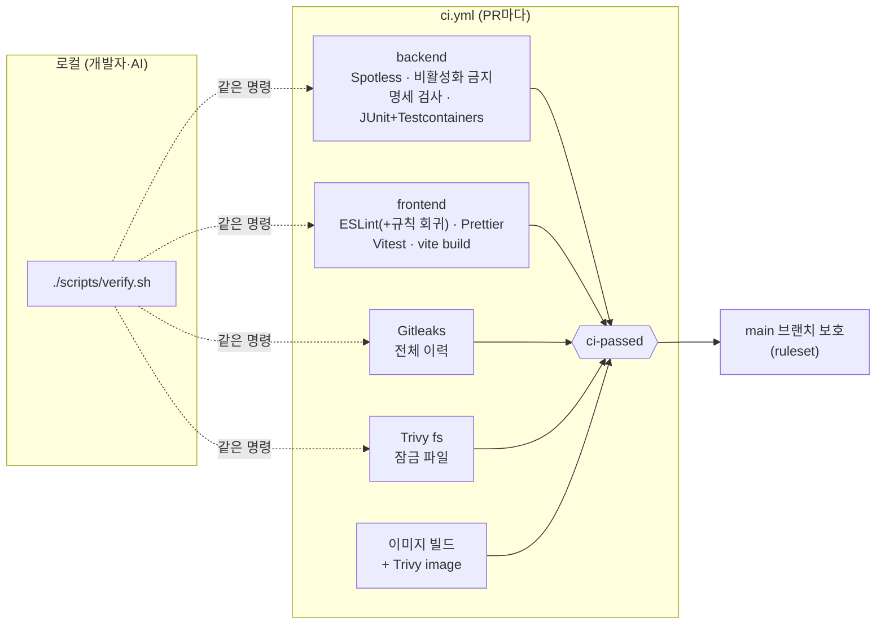

# 하네스(검증 장치) 설계 및 구성

| 항목 | 내용 |
|---|---|
| 문서 버전 | v0.1 |
| 작성일 | 2026-10-13 |
| 상태 | 초안 — **확인 필요 항목 H-Q1~H-Q4** (12장) |
| 기준 문서 | 01 요구사항 v0.2, 02 기술스택·아키텍처 v1.3 |

### 변경 이력

| 버전 | 날짜 | 변경 내용 |
|---|---|---|
| v0.1 | 2026-10-13 | 최초 작성. 이 설계로 02 문서를 v1.3으로 **먼저** 갱신함 (PR 이미지 스캔, `ci-passed`, 잠금 파일, 액션 SHA 고정 근거) |

---

## 1. 하네스란, 그리고 원칙

**하네스 = 사람(또는 AI)이 실수해도 main에 들어가기 전에 기계가 막아 주는 장치의 묶음.** 기능 코드가 하나도 없는 지금 만드는 이유는, 기능을 만들기 시작한 뒤에는 "일단 통과시키고 나중에 검사 추가"가 되기 때문이다.

| # | 원칙 | 이유 |
|---|---|---|
| H-1 | **로컬 = CI**: 같은 명령(`./scripts/verify.sh`, `./gradlew check`, `npm run verify`) | "내 PC에선 됐는데"를 없앤다 (TST-04) |
| H-2 | **요구사항은 데이터로**: 권한 매트릭스·보안 회귀 목록을 CSV 명세로 두고 테스트가 읽는다 | 문서 표와 테스트가 어긋나는 것을 기계가 잡는다 |
| H-3 | **하네스 자체도 테스트한다**: 린트 규칙·명세 파일·테스트 비활성화 여부를 검사 | 규칙을 슬쩍 끄면 빨간불이 들어온다 (특히 AI가 "통과시키려고" 끄는 것 방지) |
| H-4 | **필수 체크는 1개**(`ci-passed`) | 잡을 추가·변경해도 브랜치 보호를 고칠 필요가 없고, 빠뜨릴 수 없다 |
| H-5 | **예외는 사유·만료일과 함께 한 곳에서만** | 인라인 `eslint-disable`, 무기한 취약점 무시를 금지 |



---

## 2. 산출물 목록

| 경로 | 역할 | 장 |
|---|---|---|
| `CLAUDE.md` | AI 작업 규칙·명령어 | 10 |
| `docs/01·02·03` | 기준 문서 (저장소에도 사본 유지) | - |
| `backend/build.gradle.kts` | Spotless, 의존성 잠금(STRICT), `noDisabledTests`, JaCoCo 리포트 | 4, 5 |
| `backend/src/main/resources/application.yml` | 오류 응답·actuator 노출 최소화 기본값 | 5 |
| `backend/src/test/java/.../support/` | `IntegrationTest`, `TestcontainersConfig`, `SpecCsv` | 5 |
| `backend/src/test/java/.../harness/HarnessSmokeTest` | 하네스 자체 동작 확인 (MySQL 8.4, Flyway, utf8mb4) | 5 |
| `backend/src/test/resources/authz/permission-matrix.csv` + `PermissionMatrixSpecTest` | 권한 매트릭스 명세(46행) + 명세 검사 | 5.3 |
| `backend/src/test/resources/security/security-regression.csv` + `SecurityRegressionSpecTest` | 보안 회귀 목록(16항목) + 목록 검사 | 5.4 |
| `frontend/eslint.config.js`, `.prettierrc.json`, `vite.config.js` | 린트·포맷·빌드·테스트 설정 | 4, 5 |
| `frontend/src/__harness__/eslint-rules.test.js` | 린트 규칙 회귀 테스트 | 4.2 |
| `.gitleaks.toml`, `.trivyignore.yaml` | 스캔 설정 (예외 없음이 기본) | 6 |
| `Dockerfile`, `.dockerignore` | PR 이미지 스캔 대상 (배포에도 그대로 사용) | 6 |
| `.github/workflows/ci.yml` | PR CI | 7 |
| `.github/rulesets/main-protection.json` | 브랜치 보호(코드화) | 8 |
| `.github/pull_request_template.md` | DoD 체크리스트 | 8, 9 |
| `.github/dependabot.yml` | gradle·npm·actions·docker 업데이트 PR | 6 |
| `scripts/verify.sh` | 로컬 일괄 검사 | 1 |
| `.gitignore`, `.gitattributes`, `.editorconfig`, `.env.example`, `docker-compose.yml` | 저장소 위생, 로컬 MySQL | 3 |

---

## 3. 모노레포 폴더 구조

```
community/
├─ CLAUDE.md
├─ docs/                 01 요구사항 · 02 기술스택 · 03 하네스
├─ backend/
│  ├─ build.gradle.kts · settings.gradle.kts · gradle.lockfile · gradlew
│  └─ src/
│     ├─ main/java/com/example/community/CommunityApplication.java
│     ├─ main/resources/application.yml · db/migration/
│     └─ test/
│        ├─ java/com/example/community/
│        │  ├─ support/    IntegrationTest · TestcontainersConfig · SpecCsv
│        │  ├─ harness/    HarnessSmokeTest
│        │  ├─ authz/      PermissionMatrixSpecTest  (+ 기능 PR: PermissionMatrixTest)
│        │  ├─ security/   SecurityRegressionSpecTest (+ 기능 PR: *SecurityTest)
│        │  └─ (auth/ post/ comment/ — 기능 PR에서 AC 테스트 추가)
│        └─ resources/authz/permission-matrix.csv · security/security-regression.csv
├─ frontend/
│  ├─ package.json · package-lock.json · eslint.config.js · vite.config.js · .prettierrc.json
│  └─ src/  main.jsx · App.jsx · api/ · test/setup.js · __harness__/
├─ infra/                배포 단계에서 채움 (README만)
├─ scripts/verify.sh
├─ Dockerfile · .dockerignore · docker-compose.yml · .env.example
├─ .gitleaks.toml · .trivyignore.yaml · .gitignore · .gitattributes · .editorconfig
└─ .github/ workflows/ci.yml · rulesets/main-protection.json · pull_request_template.md · dependabot.yml
```

**왜 이렇게**
- **테스트 패키지를 "검증 목적"으로 나눔** (`authz/`, `security/`): 권한·보안 테스트가 기능 폴더 속에 흩어지면 "무엇이 검증되고 있는지" 한눈에 안 보인다.
- **명세 CSV는 `src/test/resources`**: 테스트 클래스패스에서 읽히고, 리뷰어가 diff로 기대값 변경을 바로 본다.
- **`infra/`는 비워 둠**: 배포는 다음 단계. 지금 채우면 검증되지 않은 설정이 저장소에 쌓인다.
- **`.env.example`만 커밋**: 필요한 키 이름은 공유하되 값은 각자 로컬에만.

---

## 4. 코드 품질 검사

### 4.1 백엔드

| 검사 | 설정 | 왜 필요한가 |
|---|---|---|
| Spotless (google-java-format 1.37.0) | `check`에 자동 포함 | 포맷 논쟁 제거, diff가 의미 있는 변경만 보이게 |
| `noDisabledTests` | `@Disabled`, `@DisabledIf*`, `@Ignore`가 `src/test`에 있으면 실패 | 실패 테스트를 "꺼서" 통과시키는 가장 흔한 우회로 차단 |
| 의존성 잠금 (STRICT) | `gradle.lockfile` 없거나 불일치 시 빌드 실패 | 재현 가능한 빌드 + Trivy fs가 실제 버전을 스캔 |
| JaCoCo | 리포트만, 수치 게이트 없음 | 커버리지 숫자 맞추기용 테스트를 만들지 않게 (02 문서 6.2) |

### 4.2 프론트엔드

| 검사 | 설정 | 왜 필요한가 |
|---|---|---|
| ESLint 9 (`--max-warnings=0`) | 02 문서 6.2절 규칙 전부 | TS가 없으니 오타·형변환·위험 API를 여기서 잡는다 |
| **인라인 설정 금지** | `linterOptions.noInlineConfig: true` | `// eslint-disable` 한 줄로 보안 규칙을 끄는 것을 차단. 예외는 `eslint.config.js`에서만(리뷰 대상) |
| **`.only`/`.skip` 금지** | 테스트 파일에 `no-restricted-properties` | 다른 테스트를 조용히 빼는 것 차단 |
| **린트 규칙 회귀 테스트** | `src/__harness__/eslint-rules.test.js` (15건) | 누가 설정에서 `react/no-danger`를 꺼도 Vitest가 실패한다 — 실제로 끄고 실패하는 것 확인함 |
| Prettier | `format:check` | 포맷 통일 |
| `vite build` | CI 단계 | 문법 오류·없는 import를 빌드에서 잡음 |

**ESLint 9를 쓰는 이유**: `eslint-plugin-react`가 아직 ESLint 10을 지원하지 않는다(peer 범위 `^9.7`까지). `--legacy-peer-deps`로 억지 설치하지 않고 지원 범위 안의 최신(9.39.x)으로 고정했다. Dependabot이 eslint 묶음 업데이트 PR을 만들면 그때 올린다.

---

## 5. 테스트 구조

### 5.1 계층

| 계층 | 위치 | 실행 | 지금 있는 것 | 기능 PR에서 추가 |
|---|---|---|---|---|
| 단위 | 기능 패키지 옆 | JUnit, DB 없음 | — | 이메일 마스킹, 입력 정규화 |
| 하네스 스모크 | `harness/` | `@IntegrationTest` | MySQL 8.4·Flyway·utf8mb4 확인 | — |
| API 통합 (AC) | `auth/`, `post/`, `comment/` | `@IntegrationTest` | — | 01 문서 4장 AC 전부 |
| 권한 매트릭스 | `authz/` | 명세 검사(단위) + 실행(통합) | `PermissionMatrixSpecTest` | `PermissionMatrixTest` |
| 보안 회귀 | `security/` | 목록 검사(단위) + 실행(통합) | `SecurityRegressionSpecTest` | `*SecurityTest` |
| 프론트 | `frontend/src/**/*.test.jsx` | Vitest + RTL(jsdom) | 스모크, 린트 규칙 회귀 | 텍스트 렌더링(SEC-08), 버튼 표시(canEdit/canDelete) |

**`@IntegrationTest`** = `@SpringBootTest` + MockMvc + `test` 프로필 + Testcontainers MySQL(`mysql:8.4`). 설정을 한 어노테이션으로 통일해야 Spring 컨텍스트가 재사용되어 컨테이너가 한 번만 뜬다.

### 5.2 명세 파일 방식 (PENDING → ACTIVE)

기능이 없는 지금도 **"무엇을 검증해야 하는가"는 확정**돼 있다(01 문서). 그래서 기대값을 먼저 데이터로 고정하고, 기능 PR이 하나씩 "실제 검증"으로 바꾼다.

```
PENDING  기대값은 확정, 아직 실행 테스트 없음   ← 지금 전부 여기
ACTIVE   실행 테스트가 이 행을 검증 중          ← 기능 PR이 바꿈 (DoD)
N/A      요구사항상 해당 없음 (의도적 결정)
```

- 명세 검사 테스트는 **지금 통과**하고, 매 빌드마다 CI 요약에 `ACTIVE/PENDING` 개수를 표로 남긴다 → 진척이 숫자로 보인다.
- `ACTIVE`인데 실행 테스트(클래스·메서드)가 없으면 실패 → "검증하는 척" 방지.
- `-Pharness.strict=true`면 PENDING이 하나라도 남았을 때 실패 → 언제 켤지는 **H-Q3**.

### 5.3 권한 매트릭스 명세 (`permission-matrix.csv`, 46행)

열: `case_id, req_id, method, path, actor(GUEST/USER/ADMIN), target(NONE/OWN/OTHER), expected, can_edit, can_delete, state`

`PermissionMatrixSpecTest`가 확인하는 것:

| 검사 | 막는 실수 |
|---|---|
| 02 문서 5.3절 API 12개가 정확히 있음 (모르는 API 없음) | API를 추가하고 권한 정의를 빠뜨림 |
| 모든 API에 GUEST·USER·ADMIN 세 행 | 역할 하나를 깜빡함 |
| 소유자 구분 API 5개는 USER·ADMIN 각각 OWN·OTHER | IDOR(타인 리소스) 케이스 누락 |
| 불변식: GUEST는 `can*=true` 불가, OTHER는 `can_edit=true` 불가, 타인 글 PUT은 401/403 | 01 문서 3.1 "관리자도 타인 글 수정 불가"를 명세에서 어김 |
| 불변식: GUEST의 로그인 필요 요청은 401 | AUTH-04 |
| 어휘·형식·중복 | 오타로 인한 무의미한 행 |

> 성공 상태코드(201/200/204)는 01 문서에 명시가 없어 이 명세에서 정했다 → **H-Q1**.
> 모든 매트릭스 요청은 유효한 CSRF 토큰을 포함한다고 가정한다. CSRF 누락(→403)은 보안 회귀 S-06에서 따로 검증한다 (CSRF 필터가 인증보다 먼저라 섞으면 401/403이 헷갈린다).

### 5.4 보안 회귀 목록 (`security-regression.csv`, 16항목)

| ID | 요구사항 | 내용 |
|---|---|---|
| S-01~03 | SEC-04 | `alg=none`, 서명 변조, 다른 알고리즘 → 401 |
| S-04 | SEC-06 | 만료 토큰 → 401 (Clock 주입) |
| S-05, S-07 | SEC-05, AUTH-03 | 로그인 쿠키 속성, 로그아웃 시 삭제 |
| S-06 | SEC-05 | CSRF 토큰 없는 상태 변경 요청 → 403 (로그인 포함) |
| S-08, S-09 | SEC-02, 03 | BCrypt 저장, 72바이트 초과 거부 |
| S-10, S-11 | DATA-05, SEC-08 | 민감 필드 미노출, 스크립트 문자열 무변형 왕복 |
| S-12, S-13 | SEC-10 | 오류 응답 내부정보 없음, actuator는 health만 |
| S-14, S-15 | SEC-13, 14 | 외부 Origin에 CORS 헤더 없음, 보안 헤더 존재 |
| S-16 | AUTH-02 | 없는 이메일/틀린 비밀번호 응답 동일 (계정 열거 방지) |

`SecurityRegressionSpecTest`: 필수 요구사항 ID(SEC-02·03·04·05·06·08·10·13·14, DATA-05, AUTH-02)가 모두 목록에 있는지, ACTIVE 항목의 `test_ref`(예: `JwtTokenSecurityTest#algNoneTokenIsRejected`)가 **실제로 존재하는 메서드인지** 리플렉션으로 확인한다. 보안 테스트를 지우거나 이름을 바꾸면 빌드가 깨진다.

---

## 6. 보안 검사

| 도구 | 대상 | 기준 | 왜 필요한가 |
|---|---|---|---|
| GitHub Push Protection | 푸시 시점 | 탐지 시 푸시 거부 | 1차 방어. Public 저장소는 커밋되는 순간 노출 |
| **Gitleaks** v8.30.1 | **전체 git 이력** (`fetch-depth: 0`) | 탐지 시 실패 | 2차 방어. 지운 시크릿도 이력엔 남는다 |
| **Trivy fs** | `gradle.lockfile`, `package-lock.json` | 수정 버전 있는 CRITICAL/HIGH | 취약 라이브러리 병합 차단 |
| **Trivy image** | PR에서 빌드한 앱 이미지 | 동일 | 베이스 이미지(OS 패키지·JRE) 취약점, Dockerfile 깨짐을 병합 전에 발견 |
| Dependabot | gradle·npm·actions·docker | 게이트 아님 | 고칠 방법(업데이트 PR)을 자동으로 가져옴 |

**설정 결정**
- Gitleaks는 `gitleaks-action` 대신 **공식 이미지를 직접 실행**: 라이선스 키 불필요, 무엇이 실행되는지 그대로 보인다.
- `--ignore-unfixed`: 고칠 방법이 없는 취약점으로 PR이 막히면 사람들은 게이트를 끄는 법부터 배운다. 수정 버전이 나오면 그때 막힌다.
- 예외는 `.trivyignore.yaml`에만, **사유(statement)와 만료일(expired_at) 필수**. 만료되면 자동으로 다시 막힌다.
- 테스트용 키도 저장소에 두지 않는다 → Gitleaks 예외(allowlist)가 필요 없는 구조.
- `npm ci --ignore-scripts`: 의존성의 설치 스크립트 실행을 막는다 (공급망 공격 완화). 이 환경에서 이 옵션으로 설치·빌드·테스트가 모두 동작함을 확인했다.

**액션 SHA 고정이 왜 중요한가 (실제 사고)**: 2026년 3월 `aquasecurity/trivy-action`의 기존 버전 태그 대부분이 악성 커밋으로 바꿔치기됐다(CVE-2026-33634). `@v0.x`처럼 **태그로 참조한 저장소는 다음 실행에서 악성 코드를 그대로 받았고**, SHA로 고정한 저장소는 영향이 없었다. 그래서 ci.yml의 모든 액션은 커밋 SHA + 버전 주석으로 고정했고, Trivy 본체 버전도 `TRIVY_VERSION`으로 명시했다.

---

## 7. GitHub Actions CI (`ci.yml`)

| 잡 | 내용 | 시간(예상) |
|---|---|---|
| `backend` | MySQL 이미지 pull → `./gradlew check` → 하네스 요약을 Job Summary에 → 실패 시 테스트 리포트 업로드 | 3~6분 |
| `frontend` | `npm ci --ignore-scripts` → lint → format:check → test → build | 1~2분 |
| `secret-scan` | Gitleaks 전체 이력 | < 1분 |
| `dependency-scan` | 잠금 파일 존재 확인 → Trivy fs | 1분 |
| `image-scan` | Docker 빌드(푸시 안 함) → Trivy image | 3~6분 |
| **`ci-passed`** | 위 5개가 **모두 success**일 때만 성공 (`if: always()`로 실패·취소·건너뜀도 실패 처리) | 수 초 |

- 트리거: `pull_request`, `workflow_call` (deploy.yml이 재사용). `pull_request_target` 금지.
- 권한: `contents: read`만. 시크릿을 하나도 쓰지 않음 → 포크 PR도 안전하게 실행.
- 같은 PR의 이전 실행은 자동 취소(`concurrency`).
- `actionlint`로 워크플로 문법·셸 검사 통과 확인함.

**왜 집계 잡인가**: 브랜치 보호에 잡 5개를 각각 등록하면, 잡 이름을 바꾸거나 추가할 때 보호 규칙도 고쳐야 하고, 깜빡하면 새 잡은 "필수가 아닌" 상태가 된다. 또 경로 필터 등으로 잡이 **건너뛰어지면 GitHub은 그것을 통과로 취급**할 수 있는데, `ci-passed`는 건너뜀도 실패로 본다.

---

## 8. 브랜치 보호 규칙과 PR 템플릿

### 8.1 룰셋 (`.github/rulesets/main-protection.json`)

| 규칙 | 값 | 이유 |
|---|---|---|
| 대상 | 기본 브랜치(main) | — |
| 우회 허용 | **없음** (관리자 포함) | "급하니까 직접 푸시"를 원천 차단. 혼자 하는 프로젝트일수록 중요 |
| 삭제·강제 푸시 금지 | on | 이력 보존 |
| 선형 이력 + squash 병합만 | on | PR 1개 = 커밋 1개 → 배포·롤백 단위가 명확 |
| PR 필수 | on | 모든 변경이 CI를 거침 |
| 승인 인원 | **0** (→ H-Q2) | 1인 개발은 본인 PR을 승인할 수 없다 |
| 새 푸시 시 기존 승인 무효 | on | 승인 후 몰래 바뀌는 코드 방지 (승인 인원 1 이상일 때 의미) |
| 리뷰 대화 해결 필수 | on | 지적 사항을 무시한 병합 방지 |
| 필수 상태 체크 | `ci-passed` (GitHub Actions 앱) | 7장 |
| 최신 main 기준 통과 필수(strict) | on | main이 바뀐 뒤 검증 안 된 조합이 병합되는 것 방지 |

적용: 저장소에 첫 푸시 후
```bash
gh api -X POST repos/<OWNER>/<REPO>/rulesets --input .github/rulesets/main-protection.json
```
(또는 Settings → Rules → Rulesets → Import a ruleset). 파일로 관리하면 보호 규칙의 변경도 PR 리뷰 대상이 된다.

**함께 켤 저장소 설정** (02 문서 7장): Secret scanning + Push protection / Actions → 외부 기여자 워크플로 승인 필요 / Workflow permissions → Read repository contents.

### 8.2 PR 템플릿

`.github/pull_request_template.md`는 9장 DoD를 체크리스트로 옮긴 것이다. 요구사항 ID, 문서 선갱신, 테스트 선작성, 매트릭스 행 ACTIVE 전환, 보안 자체 점검, `verify.sh` 통과를 적게 한다. **기계가 못 잡는 것(문서 먼저, 테스트 먼저, 기대값을 낮추지 않았는지)을 사람이 확인하는 자리**다.

---

## 9. 완료의 정의 (Definition of Done)

PR 하나가 "완료"이려면 아래를 **모두** 만족한다. 🤖 = 하네스가 자동으로 막음, 👤 = 리뷰·자기 점검.

### 9.1 문서 먼저 (코드 작업 전)

| # | 조건 | |
|---|---|---|
| D-1 | 범위·동작·API·스키마·보안 규칙이 바뀌는 결정이면, **01/02/03 문서를 먼저 갱신**했다 (버전, 변경 이력, 결정 기록 포함). 같은 PR이라면 문서 변경이 첫 커밋이다 | 👤 |
| D-2 | 01 문서 7장(제외 항목)의 기능을 추가하지 않았다. 필요하면 사용자 요청 → 문서 갱신 → 그다음 코드 | 👤 |
| D-3 | 권한이 바뀌면 `permission-matrix.csv`를 문서와 함께 갱신했다 | 🤖 일부 (명세 검사) |

### 9.2 테스트 먼저

| # | 조건 | |
|---|---|---|
| D-4 | AC 테스트를 구현보다 먼저 작성했고, 구현 전 실패를 확인했다 | 👤 |
| D-5 | 해당 매트릭스 행·보안 회귀 항목을 `ACTIVE`로 바꿨고, 실제로 검증하는 테스트가 있다 | 🤖 (ACTIVE↔테스트 연결 검사) |
| D-6 | 테스트를 끄지 않았다 (`@Disabled`, `.skip`, `.only`) | 🤖 |
| D-7 | 실패한 테스트의 기대값을 구현에 맞춰 바꾸지 않았다 (요구사항 변경은 D-1을 거침) | 👤 |

### 9.3 품질·보안

| # | 조건 | |
|---|---|---|
| D-8 | `./scripts/verify.sh` 로컬 통과, CI `ci-passed` 통과 | 🤖 |
| D-9 | 보안 체크리스트(CLAUDE.md 3장) 자체 점검 결과를 PR에 적었다 | 👤 |
| D-10 | 린트·스캔 예외를 추가하지 않았다. 불가피하면 사유·만료일을 적고 리뷰에서 합의했다 | 🤖 일부 (인라인 금지) / 👤 |
| D-11 | 새 의존성은 이유를 적었고 잠금 파일을 함께 갱신했다 | 🤖 (STRICT 잠금) / 👤 |
| D-12 | 시크릿·`.env`를 커밋하지 않았다 | 🤖 (Push Protection, Gitleaks) |

### 9.4 마무리

| # | 조건 | |
|---|---|---|
| D-13 | 이번 PR에서 내린 결정을 요약(결정 기록 또는 PR 본문)으로 남겼다 | 👤 |

> DoD는 "모두 체크"가 목표가 아니라 **"체크하지 못한 항목의 이유가 PR에 적혀 있음"**이 목표다.

---

## 10. CLAUDE.md

이후 AI가 코드를 쓸 때 매번 읽는 규칙 파일. 요지는 다음과 같다 (전문은 저장소 루트 `CLAUDE.md`).

| 절 | 내용 | 왜 |
|---|---|---|
| 먼저 읽을 것 | 01·02·03 문서, 두 명세 CSV | AI는 이전 대화를 기억하지 못한다. 기준을 파일로 준다 |
| 절대 규칙 | 범위 제한, 문서 먼저, 테스트 먼저, **하네스 약화 금지 목록**, 시크릿, 의존성 동의 | AI가 "테스트를 통과시키는" 가장 쉬운 길(테스트 끄기, 기대값 바꾸기, 예외 추가)을 명시적으로 막는다 |
| 보안 체크리스트 | SEC-01·07·09·10·11, DATA-05, 프론트 규칙 | 프로젝트 지침의 "자체 점검 후 제시"를 구체 항목으로 |
| 테스트 작성 규칙 | `@IntegrationTest`, 한글 AC 이름, CSRF 포함, Clock 주입, PENDING→ACTIVE | 일관된 테스트 모양 |
| 명령어 | verify.sh, gradlew, npm 스크립트, strict, 잠금 갱신 | AI가 추측하지 않고 같은 명령을 쓰게 |
| 작업 순서 | 요구사항 확인 → 실패 테스트 제시 → 구현 → 점검 → verify → DoD | 프로젝트 지침과 동일 순서 |

---

## 11. 이 환경에서의 검증 결과와 최초 설정 절차

### 11.1 검증 결과

| 항목 | 결과 |
|---|---|
| 프론트 `npm run verify` (lint·format·test·build) | ✅ 통과 (테스트 16건) |
| 프론트 `npm ci --ignore-scripts` 후 동일 | ✅ 통과 |
| 린트 규칙 회귀 테스트가 실제로 잡는지 | ✅ `react/no-danger`를 끄자 해당 테스트 실패 확인 후 원복 |
| `npm audit` | ✅ 취약점 0 |
| `ci.yml` actionlint | ✅ 통과 |
| 명세 CSV 불변식 (Python으로 동일 규칙 재검사) | ✅ 46행·16항목 통과 |
| 백엔드 `./gradlew check`, Docker 이미지 빌드, Gitleaks·Trivy 실행 | ⚠️ **미실행** — 작업 환경에서 Maven Central·Gradle 배포 서버·Docker 데몬에 접근할 수 없었다. 아래 절차의 3~4단계에서 처음 실행된다 |

> 백엔드 의존성 좌표는 Spring Boot 4.1(모듈화된 starter: `starter-webmvc`, `starter-flyway`, `starter-webmvc-test` 등)과 Testcontainers 2.x(`org.testcontainers.mysql.MySQLContainer`) 기준이다. 첫 빌드에서 해결되지 않는 좌표가 있으면 그 오류를 그대로 공유해 주면 고친다.

### 11.2 최초 설정 절차 (1회)

```bash
# 1. 저장소 준비
git init community && cd community   # 산출물 압축을 여기에 푼다
# 2. Gradle Wrapper 생성 (로컬에 Gradle 8.14+ 필요, 또는 IntelliJ의 Gradle로)
#    SHA-256은 https://gradle.org/release-checksums/ 의 9.8.1 "Binary-only" 값
cd backend
gradle wrapper --gradle-version 9.8.1 --distribution-type bin --gradle-distribution-sha256-sum <SHA256>
# 3. 포맷 정리 → 잠금 파일 생성 → 하네스 실행
./gradlew spotlessApply
./gradlew resolveAndLockAll --write-locks
./gradlew check            # HarnessSmokeTest + 명세 검사 통과해야 함 (Docker 실행 중이어야 함)
cd ..
# 4. 전체 검사
./scripts/verify.sh
# 5. 첫 커밋 → GitHub(Public)에 푸시 → 8.1절 저장소 설정 + 룰셋 적용
# 6. 시험 PR: 일부러 console.log 한 줄 넣은 PR을 올려 ci-passed가 막는지 확인 → 닫기
```

6단계는 수업 시연용으로도 좋다: "규칙을 어기면 기계가 막는다"를 직접 보여 줄 수 있다.

---

## 12. 확인 필요 항목

| # | 질문 | 현재 기본값 (답이 없으면 이대로) | 영향 |
|---|---|---|---|
| **H-Q1** | 성공 응답 코드를 이렇게 정해도 될까요? 생성(회원가입·글·댓글) **201**, 로그인·조회·수정·me **200**, 로그아웃·삭제 **204** | 왼쪽 그대로 | 01 문서에 명시 없음 → 확정 시 01 문서 v0.3에 AC로 추가하고 매트릭스 유지 |
| **H-Q2** | PR 승인 인원 — 혼자 개발이면 0, 강사·동료가 리뷰한다면 1? | **0** (CI만 필수) | 1이면 본인 PR을 본인이 병합할 수 없음. 수업에서 수강생끼리 리뷰시킬 계획이면 1 추천 |
| **H-Q3** | strict 모드(PENDING 0개 강제)를 언제 켤까요? (A) 배포 워크플로에서 처음부터 → 모든 기능 완성 전엔 배포 불가 / (B) MVP 기능 완료 후 배포 워크플로에서 켬 / (C) 안 켬 | **B** — 기능이 하나도 없을 때도 "빈 앱 배포"로 파이프라인을 먼저 검증할 수 있게 | 04(배포) 문서의 deploy.yml 설계 |
| **H-Q4** | 로컬 안전장치를 더 둘까요? (a) Git pre-commit 훅으로 Gitleaks 실행 (b) Claude Code 설정(`.claude/settings.json`)으로 `.env` 읽기·`git push --force` 등 위험 명령 차단 | **둘 다 안 함** — CI·Push Protection으로 충분, 설정 파일 수를 줄임 | (b)는 "AI에게 규칙을 글로 주는 것(CLAUDE.md) vs 도구로 강제하는 것"의 차이를 보여 주는 수업 소재로 쓸 수 있음 |

> 베이스 이미지 digest 고정(현재는 태그 고정 + Dependabot)은 배포 단계(04 문서)에서 함께 결정한다.

---

## 13. 결정 기록

| # | 날짜 | 결정 | 근거 / 영향 | 상태 |
|---|---|---|---|---|
| HD-1 | 2026-10-13 | 필수 체크는 집계 잡 `ci-passed` 1개 | 잡 추가 시 보호 규칙 수정 불필요, 건너뜀도 실패 처리 | 확정 (02 v1.3) |
| HD-2 | 2026-10-13 | PR CI에서 이미지 빌드 + Trivy image 실행 (푸시 안 함) | 베이스 이미지 취약점·Dockerfile 오류를 병합 전에 발견 | 확정 (02 v1.3) |
| HD-3 | 2026-10-13 | Gradle 의존성 잠금 STRICT + `gradle.lockfile` 커밋 | Trivy fs 입력, 재현 가능 빌드 | 확정 (02 v1.3) |
| HD-4 | 2026-10-13 | 권한 매트릭스·보안 회귀를 CSV 명세로 관리, PENDING/ACTIVE/N/A 상태 + 명세 검사 테스트 | 문서↔테스트 불일치를 기계가 감지, 진척 가시화 | 확정 |
| HD-5 | 2026-10-13 | 하네스 약화 차단: `noDisabledTests`, ESLint `noInlineConfig`, `.only/.skip` 금지, 린트 규칙 회귀 테스트 | 특히 AI가 테스트를 통과시키려고 검사를 끄는 것 방지 | 확정 |
| HD-6 | 2026-10-13 | ESLint 9.39.x 고정 (10 미사용) | `eslint-plugin-react` peer 범위. 강제 설치 금지 | 확정 |
| HD-7 | 2026-10-13 | 모든 액션 SHA 고정, Trivy 버전 명시, Gitleaks는 공식 이미지 직접 실행 | trivy-action 태그 탈취 사고(CVE-2026-33634) | 확정 |
| HD-8 | 2026-10-13 | `npm ci --ignore-scripts` (CI·Docker·verify.sh) | 설치 스크립트 공급망 공격 완화. 동작 확인함 | 확정 |
| HD-9 | 2026-10-13 | Trivy는 `--ignore-unfixed`, 예외는 사유·만료일 필수 | 고칠 수 없는 취약점으로 게이트를 끄는 습관 방지 | 확정 |
| HD-10 | 2026-10-13 | 브랜치 보호는 룰셋 JSON으로 코드화, 우회 없음, squash 전용 | 보호 규칙 변경도 리뷰 대상 | 확정 (승인 인원은 H-Q2) |
| HD-11 | 2026-10-13 | 성공 상태코드 201/200/204 | 매트릭스에 기대값 필요 | **확인 필요 (H-Q1)** |
